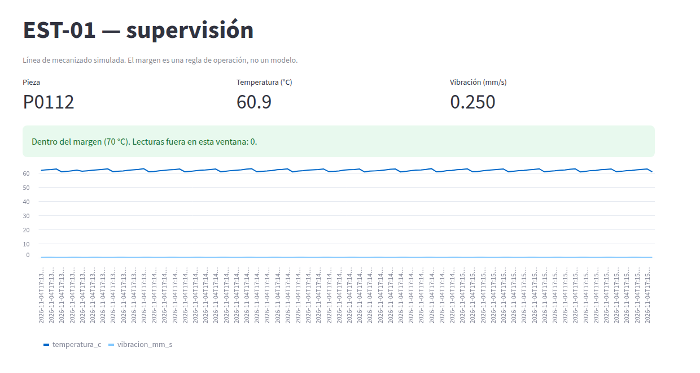

# M01-02 — Visualización y supervisión de procesos

[← Página anterior](M01-01-arquitectura-datos.md) · [Siguiente página →](../M02-captura-integracion-datos/README.md)

> Práctica del módulo. La teoría y la demostración están en el [README del módulo](README.md).
>
> Lanza los comandos desde la carpeta `infra/` del repositorio. Un paso que cuadra termina con una línea que empieza por `OK`.

### Objetivo

Comprender qué es la **supervisión de un proceso**: cómo convierte el histórico en información que el turno entiende, cómo debe ser un panel útil, cuáles son los límites de supervisar con reglas fijas y cómo se mejora.

### Prerrequisitos

- M01-01 hecho: mosquitto, sensor y archivador en marcha.
- RAM adicional del panel: hasta 512 MB. Puerto 8501 libre.

### Qué está pasando

El jefe de turno no lee los registros uno a uno. Necesita mirar una pantalla y saber en dos segundos qué carcasa está saliendo, cómo va el husillo y si algo se ha salido de lo normal.

Eso es el **panel**: la pantalla del puesto de supervisión. No escucha al broker; lee el **histórico** que llena el archivador y lo convierte en tres indicadores, un aviso y una gráfica de las últimas lecturas.

El aviso usa un **margen fijo de 70 °C**, el que marca el procedimiento de la estación. Es una regla que escribió una persona, no un modelo: avisa cuando una señal pasa un número, y no ve combinaciones raras de varias señales. Eso llegará en M03.

| En la realidad | En este laboratorio |
|----------------|---------------------|
| SCADA, HMI o un panel tipo Grafana sobre el histórico | Contenedor `panel` (Streamlit) sobre `historial.sqlite` |
| Margen de operación del procedimiento | 70 °C fijos en el código del panel |

### 1 — Arrancar el panel

Vas a levantar el puesto de supervisión y abrirlo en el navegador. Supervisar es mirar un indicador, no una tabla.

```bash
# Arranca el panel
docker compose up -d panel
```

Abre <http://localhost:8501> en Chrome.

**Resultado esperado:** la pieza actual, la temperatura, la vibración, el recuadro del margen y la serie de las últimas lecturas.



### 2 — Comprobar el dato detrás del dibujo

Vas a confirmar que el panel responde y a contar, directamente en el almacén, cuántas lecturas superan 70 °C. El número tiene que cuadrar con lo que enseña el panel.

```bash
# Pide la página del panel y cuenta lecturas en el SQLite
docker compose --profile lab run --rm --no-deps lab m01-02
```

📋 Ficha del comando [`m01-02`](../comandos-lab.md#m01-02): qué hace, qué lee, qué escribe y cuándo da `OK`.

**Resultado esperado** (cambia el número de lecturas):

```text
panel_http=200 lecturas=29 fuera_de_margen=0 umbral=70.0
OK m01-02: panel vivo, 29 lecturas, 0 fuera de 70 C
```

<details>
<summary>Qué hace por dentro (<code>infra/linea/cli.py</code>)</summary>

```python
respuesta = httpx.get(PANEL_URL)                       # el panel tiene que contestar (200)
df = pd.read_sql_query("SELECT temperatura_c FROM lecturas", con)
fuera = int((df["temperatura_c"] > UMBRAL_TEMPERATURA).sum())   # regla fija: 70 °C
```

</details>

## Comprueba tu entendimiento

**Margen visible**

Lee en el panel cuántas lecturas fuera de margen declara el recuadro verde.

→ Coincide con `fuera_de_margen` de la salida de `m01-02`.

## Reto

### 1 — Quita el panel

Para el panel y recarga la página. ¿Se pierden datos?

```bash
docker compose stop panel
```

<details>
<summary>Ver solución</summary>

La página deja de abrir, pero los ciclos siguen archivándose: el panel no es el origen. Para recuperarlo:

```bash
docker compose start panel
```

</details>

## Errores frecuentes

| Síntoma | Causa probable | Cómo arreglarlo |
|---------|----------------|-----------------|
| <http://localhost:8501> no abre | el panel no está en marcha o el puerto está ocupado | `docker compose ps` y `docker compose logs panel` |
| El panel dice que no hay histórico | el archivador acaba de crear la base | espera unos segundos y recarga |

## Conclusiones

### Qué es supervisar un proceso

Es convertir el histórico en unos pocos indicadores que una persona entiende de un vistazo: qué está pasando ahora, cómo ha ido en los últimos minutos y si algo se sale de lo normal. El panel no habla con la máquina: lee el histórico.

```
 estación ──▶ broker ──▶ archivador ──▶ historial.sqlite ──▶ panel ──▶ jefe de turno
```

### Cómo debe ser un panel útil

| Requisito | En el panel de EST-01 |
|-----------|-----------------------|
| Muestra el estado actual | Pieza, temperatura y vibración de la última carcasa |
| Muestra la tendencia | Gráfica de las últimas 120 lecturas |
| Avisa de lo anormal con un criterio explícito | Margen de 70 °C del procedimiento |
| Cuadra con el dato | El número de lecturas fuera de margen coincide con el que cuenta `m01-02` en el histórico |

### Sus límites y cómo los has visto

| Límite | Cómo lo has visto | Qué provoca |
|--------|-------------------|-------------|
| Depende del histórico | Reto: paras el panel y el histórico sigue creciendo; al revés, si se para el archivador, el panel se queda congelado sin avisar | Un panel puede enseñar datos viejos como si fueran actuales |
| Regla fija sobre una sola señal | El aviso solo mira si la temperatura pasa de 70 °C | No ve una combinación rara (temperatura normal, pero vibración y corriente altas a la vez) |
| Informa, no decide | El panel no hace nada con el aviso | La acción depende de que alguien lo mire |

### Cómo se mejora

- Mostrar la **hora del último dato** y avisar si deja de llegar, para no confundir «todo normal» con «no llega nada».
- Pasar de reglas fijas sobre una señal a **modelos que miran varias señales a la vez**: es lo que harás en M03.
- Conectar el aviso con una **acción definida** (quién revisa y qué hace), no solo con un color en pantalla.

### En una frase

> 🔑 Un panel convierte el dato en información, pero solo es tan bueno como el histórico que lee y la regla que aplica.
