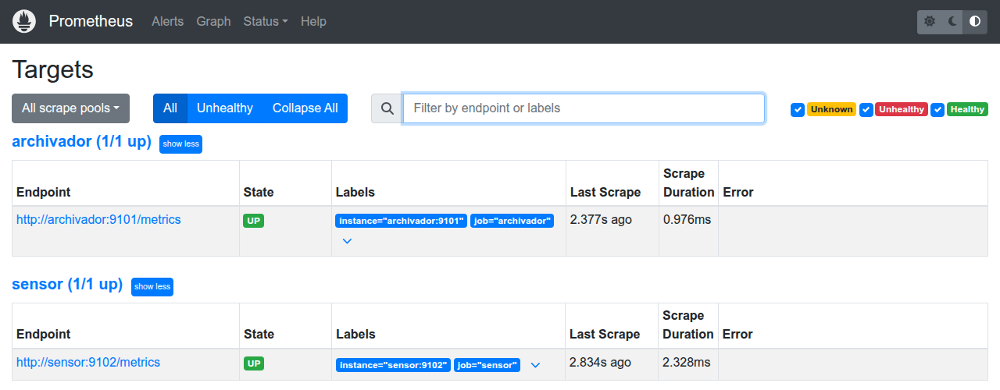
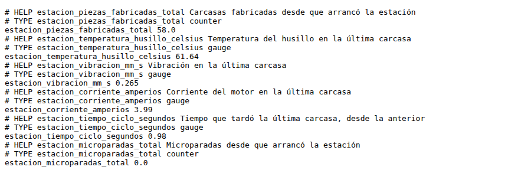
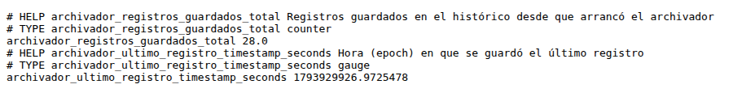
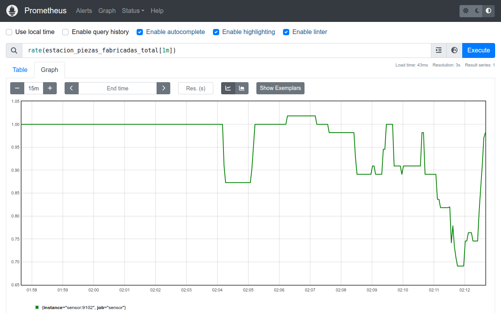
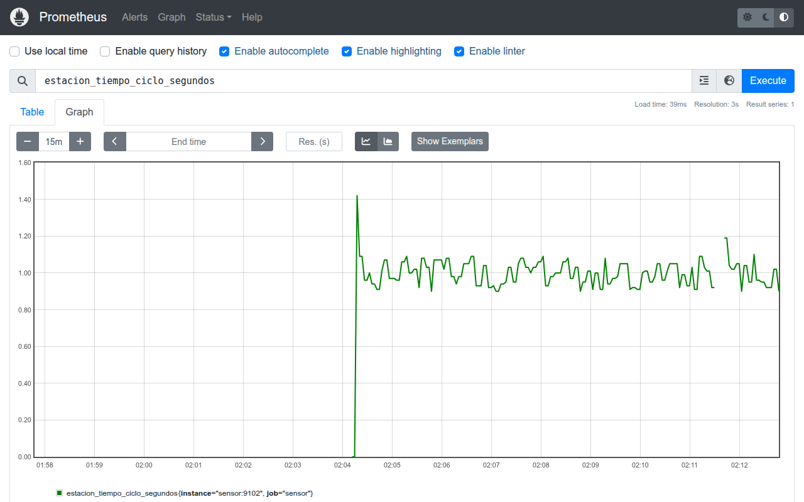
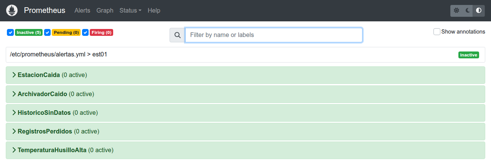
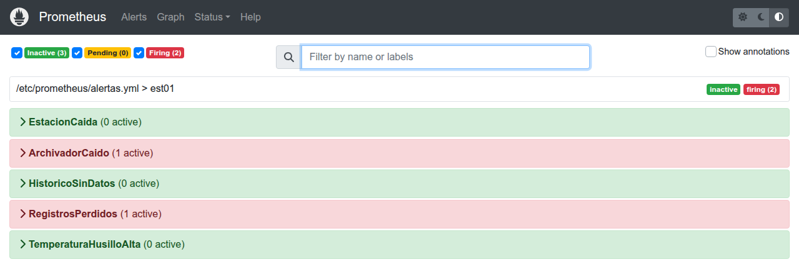

# M01-03 — Métricas y alertas de la arquitectura

[← Página anterior](M01-02-visualizacion-supervision.md) · [Siguiente página →](../M02-captura-integracion-datos/README.md)

> Práctica del módulo. La teoría y la demostración están en el [README del módulo](README.md).
>
> Lanza los comandos desde la carpeta `infra/` del repositorio.

### Objetivo

Comprender qué es la **monitorización por métricas y el alerting**: en qué se diferencia una métrica de un registro, cómo debe vigilarse la propia arquitectura de datos, cómo se diseña una alerta que avise a tiempo sin falsas alarmas y cómo se usa para encontrar y corregir un fallo silencioso.

### Prerrequisitos

- M01-01 y M01-02 hechos: mosquitto, sensor y archivador en marcha.
- Puertos 9090 (Prometheus), 9101 y 9102 (métricas del archivador y de la estación) libres. RAM del contenedor de Prometheus: hasta 256 MB.

### Qué está pasando

En el M01-02 viste el problema: el panel enseñaba «todo normal» con el archivador parado, porque solo vigilaba **el proceso** y nadie vigilaba **la arquitectura que trae los datos**. Además, el aviso solo lo veía quien estuviera mirando la pantalla.

Para eso se usan **métricas** y **alertas**:

- Cada componente publica unos pocos **números sobre sí mismo**: cuántas carcasas ha fabricado la estación, cuántos registros ha guardado el archivador, cuándo guardó el último.
- **Prometheus** va a preguntar esos números cada 5 segundos a cada componente (modelo *pull*) y los guarda como series temporales.
- Unas **reglas de alerta** escritas por una persona revisan esas series y avisan cuando algo va mal, mire quien mire la pantalla.

```
 sensor     http://localhost:9102/metrics ─┐
                                           ├──◀ Prometheus pregunta cada 5 s ──▶ reglas de alerta ──▶ alertas activas
 archivador http://localhost:9101/metrics ─┘
```

**Métrica no es lo mismo que registro:**

| | Registro (histórico SQLite) | Métrica (Prometheus) |
|--|-----------------------------|----------------------|
| Qué es | Una fila por carcasa, con su pieza, hora y medidas | Un número que resume, muestreado cada 5 s |
| Ejemplo | `P0153, 12:12:27, 62,97 °C` | `estacion_piezas_fabricadas_total 153` |
| Sirve para | Entrenar, conciliar, auditar una pieza | Vigilar tendencias y alertar |
| ¿Ve cada pieza? | Sí | No: entre muestreo y muestreo pasan unas 5 carcasas (lo verás en el paso 4) |

Las dos cosas se complementan: el histórico guarda **qué pasó con cada pieza**; las métricas dicen **si el sistema está funcionando ahora**.

| En la realidad | En este laboratorio |
|----------------|---------------------|
| Prometheus, o el módulo de alarmas del SCADA o del historian | Contenedor `prometheus` |
| Reglas de alarma del sistema de supervisión | `infra/prometheus/alertas.yml` |
| Notificación al responsable (correo, Teams, avisador) | La página de alertas de Prometheus (en el M07-03 las procesa un agente) |

### 1 — Arrancar Prometheus y ver qué vigila

**Qué ocurre:** arrancas Prometheus. Al empezar, lee su configuración (`infra/prometheus/prometheus.yml`), que le dice a quién preguntar y cada cuánto.

```bash
# Arranca Prometheus (http://localhost:9090)
docker compose up -d prometheus

# Las métricas son nuevas en la estación y el archivador: recréalos para que las publiquen
docker compose up -d --force-recreate sensor archivador
```

La parte de la configuración que importa:

```yaml
global:
  scrape_interval: 5s        # cada cuánto va a preguntar a cada contenedor
  evaluation_interval: 5s    # cada cuánto revisa las reglas de alerta

scrape_configs:
  - job_name: sensor          # la estación
    static_configs:
      - targets: ["sensor:9102"]
  - job_name: archivador      # el histórico
    static_configs:
      - targets: ["archivador:9101"]
```

Abre <http://localhost:9090/targets> en Chrome.

**Resultado esperado:** los dos objetivos en verde (`UP`), con la hora de la última consulta.



### 2 — Ver las métricas por dentro

**Qué ocurre:** antes de usar Prometheus, miras lo que cada componente le ofrece. Cada uno tiene una **dirección de métricas**: una página web de texto que Prometheus visita cada 5 segundos.

Abre en Chrome la dirección de métricas de la estación: <http://localhost:9102/metrics>

**Resultado esperado** (cambian los valores; recarga y verás cómo cambian):



**Qué es esto:** es el **formato de exposición de Prometheus**, un estándar que entiende cualquier sistema de monitorización. Cada métrica ocupa tres líneas:

| Línea | Ejemplo | Qué dice |
|-------|---------|----------|
| `# HELP` | `# HELP estacion_piezas_fabricadas_total Carcasas fabricadas desde que arrancó la estación` | Qué mide, en palabras |
| `# TYPE` | `# TYPE estacion_piezas_fabricadas_total counter` | De qué tipo es |
| El valor | `estacion_piezas_fabricadas_total 56.0` | Nombre y valor en este instante |

**Qué ves:** seis métricas de la estación: dos contadores (carcasas fabricadas y microparadas) y cuatro valores de la última carcasa (temperatura, vibración, corriente y tiempo de ciclo). Hay dos tipos:

| Tipo | Qué es | Ejemplo |
|------|--------|---------|
| `counter` (contador) | Solo sube; vuelve a 0 si el proceso se reinicia | Carcasas fabricadas, microparadas |
| `gauge` (indicador) | Sube y baja; es el valor de ahora | Temperatura, vibración, corriente, tiempo de ciclo |

Abre ahora la del archivador: <http://localhost:9101/metrics>



El archivador publica cuántos registros ha guardado y **cuándo guardó el último**, en segundos desde el 1 de enero de 1970 (la forma estándar de guardar una hora como número). Esta última métrica será clave en el reto 2.

**Fíjate:** esta página solo enseña **el valor de ahora**. No guarda el pasado. Guardar la serie en el tiempo es el trabajo de Prometheus.

Para ver solo los valores desde la terminal, sin las líneas de ayuda, puedes usar este comando, que baja la página y quita las líneas que empiezan por `#`:

```bash
# curl baja la página; grep -v '^#' quita las líneas de ayuda y tipo
curl -s http://localhost:9102/metrics | grep -v '^#'
```

```text
estacion_piezas_fabricadas_total 56.0
estacion_temperatura_husillo_celsius 60.88
estacion_vibracion_mm_s 0.235
estacion_corriente_amperios 4.11
estacion_tiempo_ciclo_segundos 0.9
estacion_microparadas_total 0.0
```

<details>
<summary>Qué hace por dentro (<code>infra/linea/sensor.py</code> y <code>infra/linea/metricas.py</code>)</summary>

```python
# Al arrancar, la estación define sus métricas y abre su dirección /metrics en el puerto 9102
metricas = Metricas()
metricas.definir("estacion_piezas_fabricadas_total", "counter", "Carcasas fabricadas desde que arrancó la estación")
metricas.definir("estacion_temperatura_husillo_celsius", "gauge", "Temperatura del husillo en la última carcasa")
metricas.servir(9102)

# En cada carcasa, actualiza los números
metricas.sumar("estacion_piezas_fabricadas_total")
metricas.poner("estacion_temperatura_husillo_celsius", estado["temperatura_c"])
```

El archivador hace lo mismo en el puerto 9101.

</details>

### 3 — Preguntar a Prometheus

**Qué ocurre:** en la página **Graph** de Prometheus escribes consultas en su lenguaje, PromQL. Vas a calcular el ritmo de fabricación y a compararlo con el de guardado.

Abre <http://localhost:9090/graph>, escribe cada consulta en el cuadro y pulsa **Execute**. Usa la pestaña **Graph** para verla en el tiempo.

```promql
# Carcasas fabricadas por segundo, calculado sobre el último minuto
rate(estacion_piezas_fabricadas_total[1m])
```

```promql
# Registros guardados por segundo
rate(archivador_registros_guardados_total[1m])
```

```promql
# Carcasas fabricadas en el último minuto que NO se guardaron
sum(increase(estacion_piezas_fabricadas_total[1m])) - sum(increase(archivador_registros_guardados_total[1m]))
```

**Resultado esperado:** las dos primeras dan **alrededor de 1** (entre 0,9 y 1), las dos casi iguales. La tercera, **0** o casi 0.



**Cómo se lee:** la línea en torno a 1 es la estación trabajando a su ritmo, con sus pequeñas variaciones. Los valles son minutos con microparada: se fabricó menos. Que la tercera consulta siga en 0 dice que **lo que se fabrica, se guarda**, aunque se fabrique menos. Es la misma conciliación que hiciste en SQL en el M01-01, pero calculada sola cada 5 segundos.

### 4 — Evento frente a muestra

**Qué ocurre:** comparas cómo ven la misma estación el histórico y Prometheus. El histórico guarda **un registro por carcasa**, cuando la carcasa termina: es un **evento**. Prometheus pregunta **cada 5 segundos**, pase lo que pase: es una **muestra**. Vas a ver qué se pierde con cada forma.

Primero, cuántos datos de cada tipo hay en el último minuto:

```bash
# Eventos: registros guardados en el último minuto
docker compose --profile lab run --rm --no-deps lab sql \
  "SELECT COUNT(*) AS registros FROM lecturas
   WHERE ts >= strftime('%Y-%m-%dT%H:%M:%S+00:00', 'now', '-60 seconds')"
```

```promql
# Muestras: cuántas veces ha preguntado Prometheus en el último minuto
count_over_time(estacion_piezas_fabricadas_total[1m])
```

**Resultado esperado:** unos **60 registros** en el histórico y **12 muestras** en Prometheus.

Ahora, el tiempo de ciclo en Prometheus. En <http://localhost:9090/graph>, pestaña **Graph**, con un rango de 15 minutos:

```promql
estacion_tiempo_ciclo_segundos
```



Y las microparadas, en el histórico:

```bash
docker compose --profile lab run --rm --no-deps lab sql \
  "SELECT pieza_id, ts, tiempo_ciclo_s FROM lecturas WHERE tiempo_ciclo_s > 2 ORDER BY id"
```

```text
pieza_id                        ts  tiempo_ciclo_s
   P0251 2026-11-06T02:08:28+00:00            6.89
   P0318 2026-11-06T02:09:41+00:00            6.73
   P0372 2026-11-06T02:10:41+00:00            7.20
   P0394 2026-11-06T02:11:07+00:00            5.22
```

**Cómo se lee:** en el mismo intervalo hubo **cuatro microparadas** de entre 5 y 7 segundos, y la gráfica de Prometheus **no enseña ninguna**. El valor de 6,89 s solo estuvo en la página de métricas desde que terminó esa carcasa hasta que terminó la siguiente, apenas un segundo, y Prometheus pregunta cada 5: no lo vio nunca.

| | Evento (histórico) | Muestra (Prometheus) |
|--|--------------------|----------------------|
| Cuándo se produce | Cuando pasa algo: termina una carcasa | Cada 5 s, pase lo que pase |
| Cuántos por minuto | Los que haya: unos 60, menos con microparadas | Siempre 12 |
| Ve una microparada | Sí, en el `tiempo_ciclo_s` de la carcasa siguiente | No, si dura menos que el intervalo de muestreo |
| Sirve para | Saber qué pasó con cada pieza | Vigilar tendencias y alertar |

Por eso los contadores (carcasas fabricadas, microparadas) son la forma correcta de llevar eventos a Prometheus: aunque se pregunte cada 5 segundos, el contador no se pierde nada, porque acumula. Compruébalo:

```promql
# Microparadas en los últimos 15 minutos, según el contador
increase(estacion_microparadas_total[15m])
```

Da un número parecido al de filas de la consulta anterior. El contador sí las ha visto todas.

### 5 — Las reglas de alerta

**Qué ocurre:** abres las reglas que vigilan la arquitectura. Cada una es una consulta PromQL con una condición y un tiempo mínimo.

Abre `infra/prometheus/alertas.yml` en VS Code. Una de las reglas:

```yaml
      # El archivador no responde: se están perdiendo registros
      - alert: ArchivadorCaido
        expr: up{job="archivador"} == 0      # Prometheus no consigue preguntarle
        for: 10s                             # durante al menos 10 segundos seguidos
        labels: {severidad: critica}
        annotations:
          resumen: "El archivador no responde: la producción no se está guardando"
```

| Alerta | Qué vigila | Condición |
|--------|-----------|-----------|
| `EstacionCaida` | La estación responde | `up` del sensor en 0 durante 10 s |
| `ArchivadorCaido` | El archivador responde | `up` del archivador en 0 durante 10 s |
| `HistoricoSinDatos` | El archivador guarda | Más de 15 s desde el último registro guardado |
| `RegistrosPerdidos` | Todo lo fabricado se guarda | Más de 3 carcasas sin guardar en el último minuto, durante 10 s |
| `TemperaturaHusilloAlta` | El proceso | Husillo por encima de 70 °C durante 5 s |

Abre <http://localhost:9090/alerts>.

**Resultado esperado:** las cinco reglas en verde, `inactive`.



Cada alerta pasa por tres estados: **inactive** (no se cumple), **pending** (se cumple, pero aún no lleva el tiempo de `for`) y **firing** (activa).

## Comprueba tu entendimiento

**Métrica o registro**

Calidad pregunta por la temperatura de la carcasa `P0153`. ¿Lo buscas en Prometheus o en el histórico?

→ En el histórico. Prometheus solo guarda una muestra cada 5 segundos y no sabe de piezas: probablemente ni siquiera tiene la temperatura de esa carcasa.

## Reto

### 1 — Para el archivador

Para el archivador, espera 20 segundos y recarga la página de alertas.

```bash
docker compose stop archivador
```

<details>
<summary>Ver solución</summary>

`ArchivadorCaido` pasa a **pending** y, a los 10 segundos, a **firing**. Con ella se activa `RegistrosPerdidos`: la estación sigue fabricando y nada se guarda.



A diferencia del panel del M01-02, esto no depende de que alguien mire: la alerta existe aunque nadie tenga la pantalla abierta. Vuelve a arrancarlo:

```bash
docker compose start archivador
```

La alerta se apaga sola cuando Prometheus vuelve a llegar al archivador.

</details>

### 2 — Reinicia el broker

Ahora reinicia solo el broker. El archivador sigue en marcha. Espera 40 segundos y mira las alertas, el diario del archivador y el histórico.

```bash
docker compose restart mosquitto
# … espera 40 segundos …
docker compose logs --tail=3 archivador
docker compose --profile lab run --rm --no-deps lab sql \
  "SELECT pieza_id, ts FROM lecturas ORDER BY id DESC LIMIT 1"
```

¿Está caído el archivador? ¿Está guardando?

<details>
<summary>Ver solución</summary>

En la página de alertas aparecen **`HistoricoSinDatos`** y **`RegistrosPerdidos`**, pero no `ArchivadorCaido`. El diario del archivador se ha quedado parado en una carcasa, y el último registro del histórico es de hace 40 segundos.

El archivador **está vivo, pero no guarda**. Al reiniciarse el broker, el archivador se reconecta solo, pero no vuelve a suscribirse al tema, así que no le llega nada. No da ningún error: sin estas alertas, nadie se enteraría hasta que alguien echara en falta datos.

Es un **fallo silencioso**, el más peligroso. Lo detecta `HistoricoSinDatos` porque no pregunta «¿estás vivo?», sino «¿estás haciendo tu trabajo?».

Para recuperar el flujo:

```bash
docker compose restart archivador
```

`HistoricoSinDatos` se apaga en unos segundos. `RegistrosPerdidos` tarda un minuto: su ventana de cálculo es de 1 minuto y sigue viendo la pérdida hasta que sale de ella.

</details>

## Experimenta: el tiempo `for` de una alerta

**Qué ocurre:** vas a bajar el umbral de temperatura de 70 a 62,5 °C, como en el M01-02, y a ver cómo se comporta la alerta. La temperatura de la estación sube y baja en dientes de sierra: pasa de 62,5 °C unos segundos y vuelve a bajar.

**Predice:** con `for: 5s`, ¿se activará la alerta?

En `infra/prometheus/alertas.yml`, cambia en la regla `TemperaturaHusilloAlta`:

```yaml
        expr: estacion_temperatura_husillo_celsius > 70
```

por:

```yaml
        expr: estacion_temperatura_husillo_celsius > 62.5
```

Reinicia Prometheus para que lea la regla nueva y recarga la página de alertas cada pocos segundos:

```bash
docker compose restart prometheus
```

**Resultado esperado:** `TemperaturaHusilloAlta` pasa a **pending** y vuelve a **inactive** una y otra vez, **sin llegar nunca a firing**. La temperatura no se queda por encima de 62,5 °C los 5 segundos seguidos que pide `for`.

Ahora cambia `for: 5s` por `for: 0s` en esa misma regla y reinicia Prometheus otra vez.

**Resultado esperado:** la alerta se **activa y se apaga** cada pocos segundos.

**Cómo se lee:** `for` es el filtro contra las **falsas alarmas**. Sin él, una señal que oscila alrededor del umbral enciende y apaga la alerta continuamente, y el operario acaba ignorándola. Con un `for` demasiado largo, en cambio, se avisa tarde. Elegir el umbral y el `for` es una decisión de proceso, igual que el umbral de un modelo.

**Deja la regla como estaba** (`> 70` y `for: 5s`) y reinicia Prometheus:

```bash
docker compose restart prometheus
```

## Mejora el archivador: que no falle en silencio

**Qué ocurre:** vas a corregir el fallo del reto 2. El archivador se suscribe una sola vez, al arrancar. Lo correcto es suscribirse **cada vez que se conecta**, también después de una reconexión.

Abre `infra/linea/archivador.py` en VS Code. Busca estas dos líneas:

```python
    cliente = mqtt.Client(mqtt.CallbackAPIVersion.VERSION2, client_id="archivador-est01")
    cliente.on_message = on_message
```

y añade debajo:

```python
    # Suscribirse cada vez que se conecta, también tras una reconexión
    def on_connect(client, _userdata, _flags, _reason, _properties):
        client.subscribe(TOPIC_CICLO)
        print("archivador: suscrito a", TOPIC_CICLO, flush=True)

    cliente.on_connect = on_connect
```

Reinicia el archivador para cargar el cambio y repite el reto 2:

```bash
docker compose restart archivador
docker compose restart mosquitto
# … espera 40 segundos …
docker compose logs --tail=5 archivador
```

**Resultado esperado:**

```text
archivador-1  | archivador: suscrito a linea/est01/ciclo
archivador-1  | archivador: P0272
archivador-1  | archivador: P0273
```

Tras el reinicio del broker, el archivador se vuelve a suscribir y sigue guardando. `HistoricoSinDatos` ya no salta.

`RegistrosPerdidos` puede saltar igualmente durante un minuto, por las pocas carcasas que se fabricaron mientras el broker estaba caído. La corrección evita la **pérdida continua**, pero no la del propio corte. Para eso hacen falta las mejoras de arquitectura del M01-01: QoS 1 con sesión persistente o *store-and-forward*.

## Errores frecuentes

| Síntoma | Causa probable | Cómo arreglarlo |
|---------|----------------|-----------------|
| <http://localhost:9090> no abre | Prometheus no está en marcha o el puerto está ocupado | `docker compose ps` y `docker compose logs prometheus` |
| Los objetivos salen en rojo (`DOWN`) con «connection refused», o <http://localhost:9102/metrics> no abre | La estación o el archivador no se recrearon tras añadir las métricas | `docker compose up -d --force-recreate sensor archivador` |
| La regla cambiada no aparece | Prometheus no se reinició | `docker compose restart prometheus` |
| Prometheus no arranca tras editar `alertas.yml` | Error de sangría o de sintaxis en el YAML | `docker compose logs prometheus` dice la línea; compara con el bloque del lab |
| El archivador no arranca tras editar `archivador.py` | Error de sangría | `docker compose logs archivador`, o `git checkout linea/archivador.py` |

## Conclusiones

### Qué es la monitorización por métricas

Es vigilar **el sistema que trae los datos**, no solo el proceso. Cada componente publica unos pocos números sobre sí mismo; Prometheus los recoge cada pocos segundos y unas reglas los revisan. El histórico y las métricas responden a preguntas distintas:

| Pregunta | Dónde se responde |
|----------|-------------------|
| ¿Qué le pasó a la carcasa P0153? | Histórico (registros) |
| ¿Está el sistema funcionando ahora? | Prometheus (métricas) |

### Cómo debe ser una alerta útil

| Requisito | En las reglas de EST-01 |
|-----------|-------------------------|
| Vigila el trabajo, no solo que el proceso esté vivo | `HistoricoSinDatos` mira si se guarda, no solo si el archivador responde |
| Llega aunque nadie mire | La alerta existe en Prometheus sin que haya una pantalla abierta |
| Filtra las oscilaciones | `for` evita que una señal en el límite encienda y apague la alerta |
| Dice qué pasa y cuánto importa | Un resumen y una severidad en cada regla |

### Lo que has detectado con ellas

| Fallo | Alerta | Qué enseña |
|-------|--------|------------|
| Archivador parado | `ArchivadorCaido` | El fallo que también se ve en el panel, pero ahora avisa solo |
| Broker reiniciado | `HistoricoSinDatos`, `RegistrosPerdidos` | Un **fallo silencioso**: el archivador vivo y sin guardar, sin ningún error |
| Umbral en el límite | `TemperaturaHusilloAlta` en *pending* intermitente | Sin `for`, una alarma que nadie atendería |
| Microparadas que la gráfica no enseña | Paso 4: cuatro microparadas en el histórico, ninguna en `estacion_tiempo_ciclo_segundos` | Un indicador muestreado se pierde lo que dura menos que su intervalo; un contador, no |

### Cómo se perfecciona

| Límite | Mejora |
|--------|--------|
| Reconexión sin suscripción | Suscribirse en cada conexión (lo has hecho) |
| Pérdida durante el propio corte | QoS 1 con sesión persistente, o *store-and-forward* en el edge |
| La alerta solo se ve en Prometheus | Enviarla a quien tiene que actuar (Alertmanager, correo, Teams) |
| Alguien tiene que interpretar cada alerta | Un agente que la diagnostica y propone la acción del procedimiento (M07-03) |

### En una frase

> 🔑 Un sistema de datos no solo hay que construirlo: hay que vigilarlo. La alerta que más vale es la que detecta que algo dejó de hacer su trabajo sin dar ningún error.
