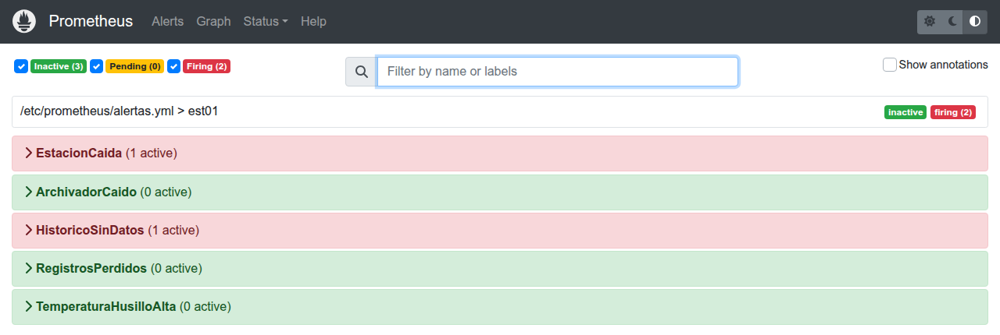

# M01 — Introducción a la IA industrial y arquitecturas basadas en datos

[← Página anterior](../../README.md) · [Siguiente página →](M01-01-arquitectura-datos.md)

> [!NOTE]
> **Cómo funciona este módulo.** Tiene tres bloques, uno por laboratorio. En cada bloque: primero la **teoría** y una **demostración** que se proyecta en clase, paso a paso; después **practicas tú** con el laboratorio, a tu ritmo. Todo lo que se ve en la demostración lo puedes repetir con los comandos de esta página.

## Qué aprenderás

- Distinguir qué hace la planta (OT), qué hace el sistema de información (IT) y qué añade la IA.
- Reconocer las piezas de una **arquitectura de datos industrial** y seguir un dato desde la máquina hasta el histórico.
- Interpretar un **panel de supervisión** y saber cuándo no puedes fiarte de lo que enseña.
- Vigilar la propia arquitectura con **métricas y alertas**, y detectar fallos que no dan ningún error.
- Entender por qué todo esto va **antes** de cualquier modelo de IA.

| Bloque | Concepto | Laboratorio |
|--------|----------|-------------|
| 1 | Arquitectura de datos: el camino del dato | [M01-01](M01-01-arquitectura-datos.md) |
| 2 | Observabilidad: del dato al indicador | [M01-02](M01-02-visualizacion-supervision.md) |
| 3 | Métricas y alertas: vigilar la arquitectura | [M01-03](M01-03-metricas-alertas.md) |

## Antes de empezar

Todos los comandos se lanzan desde la carpeta `infra/` del repositorio, en la terminal de VS Code:

```bash
cd infra
```

Si el puesto ya se usó antes (por ejemplo, en la prueba del puesto), conviene empezar con el histórico vacío para que los números se lean claros:

```bash
docker compose stop sensor archivador mosquitto
docker compose --profile lab run --rm --no-deps --entrypoint rm lab -f /data/historial.sqlite /data/estado.json
```

## Introducción: dónde encaja la IA en una fábrica

Una solución industrial con IA no empieza en el modelo. Empieza en una señal de proceso que alguien puede leer, guardar y explicar.

### De la regla fija al modelo

| Etapa | Qué decide | Límite |
|-------|------------|--------|
| Automatismo y SCADA | Umbrales y enclavamientos escritos por una persona | No ve combinaciones raras de varias señales |
| Histórico y MES | Qué ha pasado en el turno | Describe; no anticipa |
| Modelo | Una estimación (defecto, anomalía, asistencia) a partir de ejemplos | Se equivoca, y hay que vigilarlo |

> [!IMPORTANT]
> El modelo **no sustituye** el enclavamiento de seguridad. Informa a una persona o a un automatismo que ya tiene sus propias protecciones.

### IT, OT e IA

- **OT:** lo que mueve la línea. PLC, variadores, sensores, tiempos de ciclo. Prioriza que el proceso no se pare ni se vuelva inseguro.
- **IT:** lo que informa a la fábrica. Bases de datos, informes, identidad, redes de oficina.
- **IA:** una capa que lee datos de las dos y devuelve una estimación. Funciona bien cuando el dato llega con hora, unidad y contexto de línea. Funciona mal cuando solo hay un Excel mensual.

### El ciclo de una solución con IA

```
 problema de planta ──▶ datos que de verdad se capturan ──▶ modelo ──▶ puesta en marcha ──▶ vigilancia ──▶ corrección
```

Este módulo trabaja los dos primeros eslabones y el de vigilancia. Los modelos llegan en el M03, sobre los datos que montas aquí.

### La línea del curso: EST-01

Todo el curso trabaja sobre **EST-01**, una estación de mecanizado de carcasas simulada. Fabrica **una carcasa por segundo** y, mientras la mecaniza, tres sensores miden la temperatura del husillo, la vibración y la corriente del motor. Cada pieza de la arquitectura es un contenedor Docker en tu puesto.

---

## Bloque 1 — Arquitectura de datos: el camino del dato

### Teoría

Una **arquitectura de datos industrial** es la cadena de componentes que lleva el dato desde la máquina hasta donde se usa:

```
 ORIGEN                      TRANSPORTE                ALMACÉN                  PANEL            ACCIÓN
 la estación emite ────────▶ el broker reparte ──────▶ el archivador guarda ──▶ indicadores ──▶ aviso, orden,
 un registro por carcasa     a quien escuche           una fila por registro                    ayuda al técnico
```

| Pieza | En EST-01 | Qué hace | Qué **no** hace |
|-------|-----------|----------|-----------------|
| Origen | `sensor` | Al terminar cada carcasa, publica su **registro**: pieza, hora y medidas | — |
| Transporte | `mosquitto` (broker MQTT) | Entrega una copia de cada registro a todos los suscritos | **No guarda nada.** Lo que nadie escucha se pierde |
| Almacén | `archivador` + `historial.sqlite` | Guarda cada registro como una fila | No comprueba si un identificador ya existía |

En planta, el origen sería la máquina, sus sensores, el PLC y una pasarela que publica; el almacén, un historian o la base de datos del MES.

> [!NOTE]
> **Dos viajes distintos.** La pieza física viaja por las estaciones de la línea (mecanizado → montaje → calidad). Su **registro** viaja por las piezas de la arquitectura (sensor → transporte → almacén → panel). En el laboratorio solo hay una estación: cada registro es una carcasa distinta que termina su ciclo allí.

Lo que hace que un dato se pueda seguir de punta a punta es que cada registro lleva **estación, pieza y hora**.

### Demostración

La demostración sigue **una carcasa** desde que sale de la máquina hasta que queda en el histórico. En el laboratorio comprobarás el camino entero y lo pondrás a prueba.

**1. Encender la línea.**

```bash
docker compose up -d mosquitto sensor archivador
```

Desde este momento la estación fabrica una carcasa por segundo.

**2. Coger una carcasa al vuelo.** Nos suscribimos al broker y nos quedamos con el siguiente registro que publique la estación:

```bash
# -C 1: sale en cuanto recibe un mensaje
docker compose exec mosquitto mosquitto_sub -t 'linea/est01/ciclo' -C 1
```

```text
{"estacion": "EST-01", "pieza_id": "P33825", "ts": "2026-11-06T01:06:48+00:00", "temperatura_c": 61.48, "vibracion_mm_s": 0.22, "corriente_a": 4.05, "secuencia": 33825}
```

Es la ficha de una carcasa concreta: cuál es, cuándo terminó y qué midieron los sensores. Fíjate en que hemos recibido **la siguiente** que se fabricó, no las anteriores: el broker reparte lo que pasa en ese momento.

**3. Buscarla en el histórico.** Con el identificador de la carcasa (cambia el `P33825` por el tuyo):

```bash
docker compose --profile lab run --rm --no-deps lab sql \
  "SELECT pieza_id, ts, temperatura_c, vibracion_mm_s, corriente_a FROM lecturas WHERE pieza_id = 'P33825' ORDER BY id DESC LIMIT 1"
```

```text
pieza_id                        ts  temperatura_c  vibracion_mm_s  corriente_a
  P33825 2026-11-06T01:06:48+00:00          61.48            0.22         4.05
```

La misma carcasa, con la misma hora y las mismas medidas, ya está guardada. Ha cruzado los tres tramos: la estación la emitió, el broker la repartió y el archivador la guardó.

**4. La pregunta que abre el laboratorio:** si el archivador no hubiera estado escuchando en ese segundo, ¿dónde estaría ahora esa carcasa?

### Ahora tú: M01-01

→ **[M01-01 — Arquitectura básica de datos](M01-01-arquitectura-datos.md)**

Recorrerás el camino completo con la comprobación del laboratorio y el diario de cada componente. Después investigarás el histórico con tus propias consultas, provocarás fallos (parar la estación, parar el archivador, reiniciar la estación) para ver dónde se rompe esta arquitectura, y comprobarás dos mejoras: una clave que sí identifica cada carcasa y la conciliación entre lo fabricado y lo registrado.

---

## Bloque 2 — Observabilidad: del dato al indicador

### Teoría

Para saber si el proceso va bien, la máquina tiene que **emitir señales** y alguien tiene que poder **interpretarlas**. A esa capacidad de entender el estado de un sistema a partir de lo que emite se la llama **observabilidad**.

| | Pregunta que responde | Cuándo | En el curso |
|--|-----------------------|--------|-------------|
| **Supervisión** | ¿Está todo dentro de lo normal ahora? | En tiempo real | El panel |
| **Observabilidad** | ¿Puedo entender qué le pasa con lo que emite, incluso ante preguntas no previstas? | En tiempo real y después | Panel + logs + histórico consultable |
| **Análisis a posteriori** | ¿Qué pasó, por qué y con qué se relaciona? | Después | Datos y modelos (M02 y M03) |

El **panel** es la capa que convierte el histórico en **indicadores**: enseña la última carcasa, la tendencia y un aviso con un **margen fijo de 70 °C**, el del procedimiento de la estación. Es una regla escrita por una persona, no un modelo.

Dos precisiones:
- El panel enseña **indicadores de proceso** (temperatura, vibración), no **KPI de producción** como el OEE o la tasa de rechazo.
- Un aviso en pantalla **no es una alerta**: solo lo ve quien esté mirando. Las alertas llegan en el bloque 3.

### Demostración

La demostración compara el mismo dato **en crudo** y **convertido en información**. En el laboratorio calcularás tú los indicadores y descubrirás cuándo el panel engaña.

**1. El dato en crudo.** Las últimas ocho carcasas del histórico, tal como están guardadas:

```bash
docker compose --profile lab run --rm --no-deps lab sql \
  "SELECT pieza_id, ts, temperatura_c, vibracion_mm_s, corriente_a FROM lecturas ORDER BY id DESC LIMIT 8"
```

```text
pieza_id                        ts  temperatura_c  vibracion_mm_s  corriente_a
  P33831 2026-11-06T01:06:54+00:00          61.11           0.235         4.08
  P33830 2026-11-06T01:06:53+00:00          63.15           0.220         3.99
  P33829 2026-11-06T01:06:52+00:00          62.77           0.280         4.09
  ...
```

**Pregunta a la clase:** ¿va bien la estación? Con una tabla así, cuesta responder. Y son solo ocho segundos de producción.

**2. El mismo dato, en el panel.** Se arranca y se abre <http://localhost:8501>:

```bash
docker compose up -d panel
```


Ahora la respuesta está en dos segundos: qué carcasa sale, cómo está el husillo, si estamos dentro del margen del procedimiento y cómo ha ido el último par de minutos. Es el paso de **dato** a **información operativa**.

**3. De dónde sale cada cosa.** El panel no habla con la máquina: lee el mismo histórico que acabamos de consultar. Su código está en `infra/linea/panel.py` y su margen, en `infra/linea/config.py`.

**4. La pregunta que abre el laboratorio:** el recuadro está en verde. ¿Significa que todo va bien?

### Ahora tú: M01-02

→ **[M01-02 — Visualización y supervisión de procesos](M01-02-visualizacion-supervision.md)**

Calcularás los indicadores tú, moverás el margen para ver cómo se comporta el panel (y por qué dos indicadores «iguales» dan números distintos), congelarás el panel parando el archivador y lo mejorarás para que avise cuando sus datos no son actuales.

---

## Bloque 3 — Métricas y alertas: vigilar la arquitectura

### Teoría

El panel vigila **el proceso**. Pero ¿quién vigila **la arquitectura que trae los datos**? Si el archivador deja de guardar, el panel sigue en verde con datos viejos.

Para eso, cada componente publica unos pocos **números sobre sí mismo** (sus **métricas**): cuántas carcasas ha fabricado la estación, cuántos registros ha guardado el archivador, cuándo guardó el último. **Prometheus** va a preguntarlos cada 5 segundos y unas **reglas de alerta** los revisan, mire quien mire la pantalla.

```
 sensor :9102/metrics ─────┐
                           ├──◀ Prometheus pregunta cada 5 s ──▶ reglas de alerta ──▶ alertas activas
 archivador :9101/metrics ─┘
```

| | Registro (histórico) | Métrica (Prometheus) |
|--|----------------------|----------------------|
| Qué es | Una fila por carcasa | Un número que resume, cada 5 s |
| Sirve para | Entrenar, conciliar, auditar una pieza | Vigilar si el sistema funciona ahora y alertar |

Una **alerta** pasa por tres estados: **inactive** (no se cumple), **pending** (se cumple, pero aún no lleva el tiempo mínimo `for`) y **firing** (activa).

### Demostración

La demostración enseña la pregunta más sencilla que hace Prometheus, «¿estás vivo?», y una alerta en el caso más simple: la estación parada. En el laboratorio verás las métricas por dentro, escribirás tus consultas y descubrirás un fallo que esa pregunta no detecta.

**1. Encender Prometheus.**

```bash
docker compose up -d prometheus
docker compose restart sensor archivador    # para que publiquen sus métricas
```

**2. La pregunta «¿estás vivo?».** En <http://localhost:9090/graph> se escribe `up` y se pulsa **Execute**:

```promql
up
```

```text
up{instance="archivador:9101", job="archivador"}   1
up{instance="sensor:9102", job="sensor"}           1
```

Cada 5 segundos, Prometheus llama a la puerta de cada componente. Si contesta, `up` vale 1; si no, 0. Es la métrica más básica de cualquier sistema vigilado.

**3. Las reglas de alerta.** En <http://localhost:9090/alerts> están las cinco reglas de la línea, en verde. Cada una es una pregunta que Prometheus se hace cada 5 segundos.

**4. Parar la estación.** Se para la estación y, a los 20 segundos, se recarga la página de alertas:

```bash
docker compose stop sensor
```



Saltan dos alertas: **`EstacionCaida`**, porque la estación no contesta, y **`HistoricoSinDatos`**, porque el histórico ha dejado de recibir. Es lógico: sin producción no hay registros. La alerta existe aunque nadie tenga el panel abierto. Se vuelve a arrancar:

```bash
docker compose start sensor
```

**5. La pregunta que abre el laboratorio:** ¿y si un componente contesta «estoy vivo» pero ha dejado de hacer su trabajo?

### Ahora tú: M01-03

→ **[M01-03 — Métricas y alertas de la arquitectura](M01-03-metricas-alertas.md)**

Verás las métricas por dentro, escribirás consultas para conciliar lo fabricado con lo guardado, provocarás un **fallo silencioso** (el archivador vivo pero sin guardar) que solo detecta una de las alertas, experimentarás con el tiempo `for` para evitar falsas alarmas y corregirás el archivador para que no vuelva a fallar en silencio.

---

## Conclusiones del módulo

### Qué es una arquitectura de datos industrial

La cadena que lleva el dato desde la máquina hasta quien lo usa: **origen → transporte → almacén → panel → acción**. Cada pieza es un componente separado, con una sola función, que puede fallar por su cuenta.

### Cómo debe ser para que sirva a la IA

| Requisito | Por qué |
|-----------|---------|
| **Completa**: cada carcasa fabricada tiene su registro | Si faltan piezas, el modelo aprende de una línea que no es la real |
| **Identificable**: cada registro es de una sola carcasa | Para entrenar hay que unir las señales de una pieza con su resultado de calidad |
| **Observable**: cada indicador se puede reproducir y dice si está al día | Si no, se toman decisiones con datos viejos |
| **Vigilada**: hay alertas sobre la propia arquitectura | Los peores fallos no dan ningún error |

### Lo que has visto romperse

| Fallo | Dónde lo has visto | Qué le haría a la IA |
|-------|--------------------|----------------------|
| Carcasas fabricadas sin registro | M01-01, reto 2 | Entrenar con una producción incompleta |
| Identificadores repetidos tras un reinicio | M01-01, reto 3 | Unir señales de una pieza con el resultado de otra |
| Panel en verde con datos congelados | M01-02, reto 2 | Decidir con información vieja |
| Archivador vivo que no guarda | M01-03, reto 2 | Perder producción durante horas sin enterarse |

### Cómo se perfecciona

Clave de pieza que no se repite (MES, DataMatrix) más la hora; conciliación de lo fabricado con lo registrado; indicadores con la hora del último dato; alertas que vigilan el trabajo de cada componente, no solo que esté vivo; reconexiones correctas, y, para no perder nada en los cortes, QoS 1 o *store-and-forward* en el edge.

### En una frase

> 🔑 La IA en planta vale lo que vale el dato que recibe. Antes de construir modelos hay que conseguir que el dato llegue completo, sea de la pieza que crees y que alguien se entere cuando deja de llegar.
