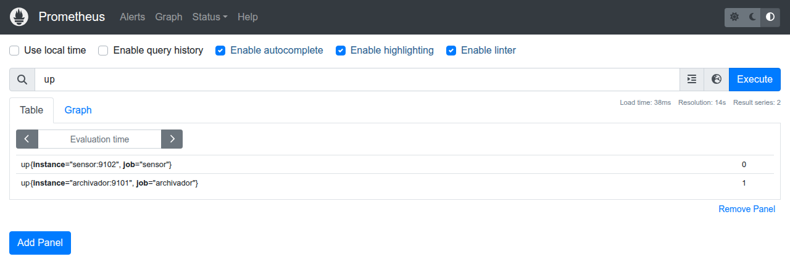

# M01 — Introducción a la IA industrial y arquitecturas basadas en datos

[← Página anterior](../../README.md) · [Siguiente página →](M01-01-arquitectura-datos.md)

> [!NOTE]
> **Cómo funciona este módulo.** Tiene tres bloques, uno por laboratorio. En cada bloque: primero la **teoría** y una **demostración** que se proyecta en clase, paso a paso; después **practicas tú** con el laboratorio, a tu ritmo. Todo lo que se ve en la demostración lo puedes repetir con los comandos de esta página.

## Qué aprenderás

- Distinguir qué hace la planta (OT), qué hace el sistema de información (IT) y qué añade la IA.
- Reconocer las piezas de una **arquitectura de datos industrial** y seguir un dato desde la máquina hasta el histórico.
- Interpretar un **panel de supervisión** y saber cuándo no puedes fiarte de lo que enseña.
- Vigilar la propia arquitectura con **métricas y alertas**, y detectar fallos que no dan ningún error.
- Entender por qué todo esto va **antes** de cualquier modelo de IA.

| Bloque | Concepto | Laboratorio |
|--------|----------|-------------|
| 1 | Arquitectura de datos: el camino del dato | [M01-01](M01-01-arquitectura-datos.md) |
| 2 | Observabilidad: del dato al indicador | [M01-02](M01-02-visualizacion-supervision.md) |
| 3 | Métricas y alertas: vigilar la arquitectura | [M01-03](M01-03-metricas-alertas.md) |

## Antes de empezar

Todos los comandos se lanzan desde la carpeta `infra/` del repositorio, en la terminal de VS Code:

```bash
cd infra
```

Si el puesto ya se usó antes (por ejemplo, en la prueba del puesto), conviene empezar con el histórico vacío para que los números se lean claros:

```bash
docker compose stop sensor archivador mosquitto
docker compose --profile lab run --rm --no-deps --entrypoint rm lab -f /data/historial.sqlite /data/estado.json
```

## Introducción: dónde encaja la IA en una fábrica

Una solución industrial con IA no empieza en el modelo. Empieza en una señal de proceso que alguien puede leer, guardar y explicar.

### De la regla fija al modelo

| Etapa | Qué decide | Límite |
|-------|------------|--------|
| Automatismo y SCADA | Umbrales y enclavamientos escritos por una persona | No ve combinaciones raras de varias señales |
| Histórico y MES | Qué ha pasado en el turno | Describe; no anticipa |
| Modelo | Una estimación (defecto, anomalía, asistencia) a partir de ejemplos | Se equivoca, y hay que vigilarlo |

> [!IMPORTANT]
> El modelo **no sustituye** el enclavamiento de seguridad. Informa a una persona o a un automatismo que ya tiene sus propias protecciones.

### IT, OT e IA

- **OT:** lo que mueve la línea. PLC, variadores, sensores, tiempos de ciclo. Prioriza que el proceso no se pare ni se vuelva inseguro.
- **IT:** lo que informa a la fábrica. Bases de datos, informes, identidad, redes de oficina.
- **IA:** una capa que lee datos de las dos y devuelve una estimación. Funciona bien cuando el dato llega con hora, unidad y contexto de línea. Funciona mal cuando solo hay un Excel mensual.

### El ciclo de una solución con IA

```
 problema de planta ──▶ datos que de verdad se capturan ──▶ modelo ──▶ puesta en marcha ──▶ vigilancia ──▶ corrección
```

Este módulo trabaja los dos primeros eslabones y el de vigilancia. Los modelos llegan en el M03, sobre los datos que montas aquí.

### La línea del curso: EST-01

Todo el curso trabaja sobre **EST-01**, una estación de mecanizado de carcasas simulada. Fabrica **una carcasa por segundo** y, mientras la mecaniza, tres sensores miden la temperatura del husillo, la vibración y la corriente del motor. Cada pieza de la arquitectura es un contenedor Docker en tu puesto.

---

## Bloque 1 — Arquitectura de datos: el camino del dato

### Teoría

Una **arquitectura de datos industrial** es la cadena de componentes que lleva el dato desde la máquina hasta donde se usa:

```
 ORIGEN                      TRANSPORTE                ALMACÉN                  PANEL            ACCIÓN
 la estación emite ────────▶ el broker reparte ──────▶ el archivador guarda ──▶ indicadores ──▶ aviso, orden,
 un registro por carcasa     a quien escuche           una fila por registro                    ayuda al técnico
```

| Pieza | En EST-01 | Qué hace | Qué **no** hace |
|-------|-----------|----------|-----------------|
| Origen | `sensor` | Al terminar cada carcasa, publica su **registro**: pieza, hora y medidas | — |
| Transporte | `mosquitto` (broker MQTT) | Entrega una copia de cada registro a todos los suscritos | **No guarda nada.** Lo que nadie escucha se pierde |
| Almacén | `archivador` + `historial.sqlite` | Guarda cada registro como una fila | No comprueba si un identificador ya existía |

En planta, el origen sería la máquina, sus sensores, el PLC y una pasarela que publica; el almacén, un historian o la base de datos del MES.

> [!NOTE]
> **Dos viajes distintos.** La pieza física viaja por las estaciones de la línea (mecanizado → montaje → calidad). Su **registro** viaja por las piezas de la arquitectura (sensor → transporte → almacén → panel). En el laboratorio solo hay una estación: cada registro es una carcasa distinta que termina su ciclo allí.

Lo que hace que un dato se pueda seguir de punta a punta es que cada registro lleva **estación, pieza y hora**.

### Demostración

**Qué se demuestra:** el recorrido de **una carcasa concreta** desde que sale de la máquina hasta que queda guardada, y una propiedad del broker que tiene consecuencias en todo el curso: reparte lo que pasa en el momento y no guarda nada. En el laboratorio comprobarás el camino entero y lo pondrás a prueba hasta romperlo.

#### Paso 1 — Encender la línea

**Qué vamos a ver:** se arrancan los tres componentes del camino del dato. Cada uno es un contenedor, un proceso aislado con su propia función. Desde este momento la estación fabrica una carcasa por segundo.

```bash
# Arranca en segundo plano (-d) la estación, el broker y el archivador
docker compose up -d mosquitto sensor archivador

# Lista los contenedores de esos tres servicios con su estado
docker compose ps mosquitto sensor archivador
```

**Resultado esperado** (cambian los tiempos):

```text
NAME                    IMAGE                 COMMAND                  SERVICE      CREATED         STATUS         PORTS
ia-linea-archivador-1   ia-linea-archivador   "python -m linea.arc…"   archivador   3 seconds ago   Up 2 seconds
ia-linea-mosquitto-1    eclipse-mosquitto:2   "/docker-entrypoint.…"   mosquitto    3 seconds ago   Up 3 seconds   0.0.0.0:1883->1883/tcp, [::]:1883->1883/tcp
ia-linea-sensor-1       ia-linea-sensor       "python -m linea.sen…"   sensor       3 seconds ago   Up 2 seconds
```

**Cómo se lee:**

| Columna | Qué dice | Qué señalar |
|---------|----------|-------------|
| `SERVICE` | El papel en la arquitectura | `sensor` = origen, `mosquitto` = transporte, `archivador` = almacén |
| `IMAGE` | De qué está hecho | `sensor` y `archivador` salen de la imagen del curso (Python + código de la línea); `mosquitto` es un broker MQTT estándar |
| `COMMAND` | Qué programa ejecuta | `python -m linea.sensor`: el código está en `infra/linea/sensor.py`, y se puede leer |
| `STATUS` | Si está en marcha | `Up`: el tramo existe |
| `PORTS` | Qué publica hacia fuera | Solo el broker abre un puerto (1883); estación y archivador hablan por dentro de la red de Docker |

> **Qué señalar en pantalla:** tres contenedores, tres responsabilidades. Si uno no está en `Up`, su tramo del camino no existe.

#### Paso 2 — Coger una carcasa al vuelo

**Qué vamos a ver:** nos conectamos al broker como un consumidor más, igual que hace el archivador, y nos quedamos con **el siguiente** registro que publique la estación.

```bash
# mosquitto_sub: cliente MQTT que se suscribe y enseña lo que llega
#   -t 'linea/est01/ciclo'  tema al que se suscribe: los registros de EST-01
#   -C 1                    sale en cuanto recibe un mensaje
docker compose exec mosquitto mosquitto_sub -t 'linea/est01/ciclo' -C 1
```

**Resultado esperado** (cambian la pieza, la hora y los valores):

```text
{"estacion": "EST-01", "pieza_id": "P1987", "ts": "2026-11-06T01:40:50+00:00", "temperatura_c": 62.96, "vibracion_mm_s": 0.25, "corriente_a": 4.05, "secuencia": 1987}
```

**Cómo se lee:** es el **registro** de una carcasa, en formato JSON:

| Campo | Valor | Qué es |
|-------|-------|--------|
| `estacion` | `EST-01` | Qué máquina la fabricó |
| `pieza_id` | `P1987` | El identificador de la carcasa |
| `ts` | `2026-11-06T01:40:50+00:00` | Cuándo terminó, en hora UTC (en España, una hora más en invierno) |
| `temperatura_c` | `62.96` | Temperatura del husillo durante el ciclo, en °C |
| `vibracion_mm_s` | `0.25` | Vibración de la máquina, en mm/s |
| `corriente_a` | `4.05` | Corriente del motor, en amperios: cuánto esfuerzo ha hecho |
| `secuencia` | `1987` | El contador interno de la estación desde que arrancó |

> **Qué señalar en pantalla:** «Esto es lo que viaja: una ficha por carcasa, con quién, cuándo y cómo se fabricó. Es la materia prima de toda la IA del curso».

#### Paso 3 — El broker reparte, no guarda

**Qué vamos a ver:** se repite el mismo comando dos veces, con unos segundos de diferencia. Si el broker guardara los mensajes, la segunda vez podríamos recibir el mismo registro, o uno anterior.

```bash
# Primera escucha
docker compose exec mosquitto mosquitto_sub -t 'linea/est01/ciclo' -C 1
# … unos segundos después, la segunda
docker compose exec mosquitto mosquitto_sub -t 'linea/est01/ciclo' -C 1
```

**Resultado esperado:**

```text
{"estacion": "EST-01", "pieza_id": "P1987", "ts": "2026-11-06T01:40:50+00:00", …}
{"estacion": "EST-01", "pieza_id": "P1991", "ts": "2026-11-06T01:40:54+00:00", …}
```

**Cómo se lee:** la segunda escucha recibe la `P1991`, la que se fabricó **cuando nos volvimos a conectar**. Las carcasas `P1988` a `P1990` se publicaron mientras no escuchábamos y no las hemos visto. El broker no las ha perdido para todos: el archivador sí estaba escuchando. Pero a nosotros no nos las va a dar nunca.

> **Qué señalar en pantalla:** «El broker es como una megafonía: lo oye quien está en la sala en ese momento. Si queremos el pasado, alguien tiene que estar siempre escuchando y apuntándolo». Ese alguien es el archivador.

#### Paso 4 — Encontrar la carcasa en el histórico

**Qué vamos a ver:** buscamos en el histórico la carcasa que cogimos al vuelo en el paso 2. `lab sql` lanza una consulta SQL contra la base de datos del archivador, en solo lectura.

```bash
# Busca la carcasa por su identificador (cambia P1987 por la que te haya salido)
docker compose --profile lab run --rm --no-deps lab sql \
  "SELECT id, pieza_id, ts, temperatura_c, vibracion_mm_s, corriente_a
   FROM lecturas WHERE pieza_id = 'P1987' ORDER BY id DESC LIMIT 1"
```

**Resultado esperado:**

```text
   id pieza_id                        ts  temperatura_c  vibracion_mm_s  corriente_a
48009    P1987 2026-11-06T01:40:50+00:00          62.96            0.25         4.05
```

**Cómo se lee:**

- La **misma carcasa**, con la **misma hora** y las **mismas medidas** que vimos pasar por el broker. Ha cruzado los tres tramos: la estación la emitió, el broker la repartió y el archivador la guardó.
- `id` es una columna nueva: el número de fila que pone la base de datos. No viene de la estación, y no coincide con el número de pieza: aquí la fila es la 48 009 y la pieza la 1987, porque el histórico guarda también carcasas de otras tandas. Por qué eso importa lo descubrirás en el laboratorio.
- `lecturas` es la tabla donde el archivador guarda una fila por registro. Su estructura completa la verás en el laboratorio.

> **Qué señalar en pantalla:** «Lo que hace posible seguir un dato de punta a punta es que lleva estación, pieza y hora. Sin eso, no sabríamos cuál de todas las filas es esta carcasa».

#### Paso 5 — La pregunta que abre el laboratorio

> **Si el archivador no hubiera estado escuchando en el segundo en que se fabricó la P1987, ¿dónde estaría ahora esa carcasa?**

Deja la pregunta abierta. En el laboratorio lo comprobarás.

### Ahora tú: M01-01

→ **[M01-01 — Arquitectura básica de datos](M01-01-arquitectura-datos.md)**

Recorrerás el camino completo con la comprobación del laboratorio y el diario de cada componente. Después investigarás el histórico con tus propias consultas, provocarás fallos (parar la estación, parar el archivador, reiniciar la estación) para ver dónde se rompe esta arquitectura, y comprobarás dos mejoras: una clave que sí identifica cada carcasa y la conciliación entre lo fabricado y lo registrado.

---

## Bloque 2 — Observabilidad: del dato al indicador

### Teoría

Para saber si el proceso va bien, la máquina tiene que **emitir señales** y alguien tiene que poder **interpretarlas**. A esa capacidad de entender el estado de un sistema a partir de lo que emite se la llama **observabilidad**.

| | Pregunta que responde | Cuándo | En el curso |
|--|-----------------------|--------|-------------|
| **Supervisión** | ¿Está todo dentro de lo normal ahora? | En tiempo real | El panel |
| **Observabilidad** | ¿Puedo entender qué le pasa con lo que emite, incluso ante preguntas no previstas? | En tiempo real y después | Panel + logs + histórico consultable |
| **Análisis a posteriori** | ¿Qué pasó, por qué y con qué se relaciona? | Después | Datos y modelos (M02 y M03) |

El **panel** es la capa que convierte el histórico en **indicadores**: enseña la última carcasa, la tendencia y un aviso con un **margen fijo de 70 °C**, el del procedimiento de la estación. Es una regla escrita por una persona, no un modelo.

Dos precisiones:
- El panel enseña **indicadores de proceso** (temperatura, vibración), no **KPI de producción** como el OEE o la tasa de rechazo.
- Un aviso en pantalla **no es una alerta**: solo lo ve quien esté mirando. Las alertas llegan en el bloque 3.

### Demostración

**Qué se demuestra:** el mismo dato **en crudo** y **convertido en información**, y de dónde sale cada cosa que enseña un panel. En el laboratorio calcularás tú los indicadores, los pondrás a prueba y descubrirás cuándo el panel engaña.

#### Paso 1 — El dato en crudo

**Qué vamos a ver:** las últimas ocho carcasas del histórico, tal como están guardadas. Es lo que tendría el operario si no hubiera panel.

```bash
# Las 8 filas más recientes de la tabla de lecturas
docker compose --profile lab run --rm --no-deps lab sql \
  "SELECT pieza_id, ts, temperatura_c, vibracion_mm_s, corriente_a
   FROM lecturas ORDER BY id DESC LIMIT 8"
```

**Resultado esperado** (cambian las piezas y los valores):

```text
pieza_id                        ts  temperatura_c  vibracion_mm_s  corriente_a
  P33831 2026-11-06T01:06:54+00:00          61.11           0.235         4.08
  P33830 2026-11-06T01:06:53+00:00          63.15           0.220         3.99
  P33829 2026-11-06T01:06:52+00:00          62.77           0.280         4.09
  P33828 2026-11-06T01:06:51+00:00          62.54           0.265         4.00
  P33827 2026-11-06T01:06:50+00:00          62.19           0.250         4.06
  P33826 2026-11-06T01:06:49+00:00          61.73           0.235         4.03
  P33825 2026-11-06T01:06:48+00:00          61.48           0.220         4.05
  P33824 2026-11-06T01:06:47+00:00          61.00           0.280         3.97
```

**Cómo se lee:** son ocho segundos de producción. Cada fila es una carcasa con sus tres medidas. Todo es correcto, pero **no responde a ninguna pregunta** por sí solo.

> **Pregunta a la clase:** «¿Va bien la estación?». Deja que contesten. Con una tabla así hay que mirar número a número, compararlos con lo que uno sabe del proceso y, aun así, solo se ven ocho segundos.

#### Paso 2 — El mismo dato, en el panel

**Qué vamos a ver:** se arranca el panel del puesto de supervisión y se abre en el navegador.

```bash
# Arranca el panel (Streamlit) en el puerto 8501
docker compose up -d panel
```

Abre <http://localhost:8501>.


**Cómo se lee:**

| Zona del panel | Qué responde | De dónde sale |
|----------------|--------------|---------------|
| Pieza, Temperatura, Vibración | ¿Qué está saliendo ahora? | La última fila del histórico |
| Recuadro verde | ¿Estamos dentro del margen? | La última temperatura comparada con 70 °C |
| Contador «fuera en esta ventana» | ¿Ha habido sustos recientes? | Lecturas por encima de 70 °C en las últimas 120 |
| Gráfica | ¿Cómo ha ido el último par de minutos? | Las últimas 120 lecturas |

Ahora la pregunta «¿va bien la estación?» se responde en dos segundos. Es el paso de **dato** a **información operativa**.

> **Qué señalar en pantalla:** el dato es el mismo que en la tabla del paso 1. Lo que ha cambiado es que alguien ha decidido qué mostrar, cómo resumirlo y con qué criterio avisar.

#### Paso 3 — De dónde sale cada indicador

**Qué vamos a ver:** el código del panel, para comprobar que no hay magia: lee el histórico y aplica una regla. Se abre `infra/linea/panel.py` en VS Code y se señalan estas líneas:

```python
# Lee las 120 lecturas más recientes del histórico (no habla con la máquina)
df = pd.read_sql_query(
    "SELECT ts, pieza_id, temperatura_c, vibracion_mm_s, corriente_a FROM lecturas ORDER BY id DESC LIMIT 120",
    con,
)

# Cuenta las que pasan del margen, y mira si la ÚLTIMA lo pasa
fuera = df[df["temperatura_c"] > UMBRAL_TEMPERATURA]
if ultimo["temperatura_c"] > UMBRAL_TEMPERATURA:
    st.error(f"Por encima del margen ({UMBRAL_TEMPERATURA:.0f} °C).")
else:
    st.success(f"Dentro del margen ({UMBRAL_TEMPERATURA:.0f} °C). Lecturas fuera en esta ventana: {len(fuera)}.")
```

Y en `infra/linea/config.py`, el margen:

```python
UMBRAL_TEMPERATURA = 70.0
```

**Cómo se lee:**

- El panel **lee el histórico**, igual que nuestra consulta del paso 1. Si el histórico no se actualiza, el panel tampoco.
- El **margen es una línea de código** que escribió una persona a partir del procedimiento. No es un modelo: no aprende ni mira combinaciones de señales.
- El recuadro decide con **la última** lectura; el contador mira **las últimas 120**. Son dos criterios distintos en la misma pantalla.

> **Qué señalar en pantalla:** «Todo lo que enseña un panel se puede reproducir con una consulta. Si no se puede reproducir, no es observabilidad: es un dibujo».

#### Paso 4 — La pregunta que abre el laboratorio

> **El recuadro está en verde. ¿Significa que todo va bien?**

Deja la pregunta abierta. En el laboratorio encontrarás al menos dos casos en los que no.

### Ahora tú: M01-02

→ **[M01-02 — Visualización y supervisión de procesos](M01-02-visualizacion-supervision.md)**

Calcularás los indicadores tú, moverás el margen para ver cómo se comporta el panel (y por qué dos indicadores «iguales» dan números distintos), congelarás el panel parando el archivador y lo mejorarás para que avise cuando sus datos no son actuales.

---

## Bloque 3 — Métricas y alertas: vigilar la arquitectura

### Teoría

El panel vigila **el proceso**. Pero ¿quién vigila **la arquitectura que trae los datos**? Si el archivador deja de guardar, el panel sigue en verde con datos viejos.

Para eso, cada componente publica unos pocos **números sobre sí mismo** (sus **métricas**): cuántas carcasas ha fabricado la estación, cuántos registros ha guardado el archivador, cuándo guardó el último. **Prometheus** va a preguntarlos cada 5 segundos y unas **reglas de alerta** los revisan, mire quien mire la pantalla.

```
 sensor :9102/metrics ─────┐
                           ├──◀ Prometheus pregunta cada 5 s ──▶ reglas de alerta ──▶ alertas activas
 archivador :9101/metrics ─┘
```

| | Registro (histórico) | Métrica (Prometheus) |
|--|----------------------|----------------------|
| Qué es | Una fila por carcasa | Un número que resume, cada 5 s |
| Sirve para | Entrenar, conciliar, auditar una pieza | Vigilar si el sistema funciona ahora y alertar |

Una **alerta** pasa por tres estados: **inactive** (no se cumple), **pending** (se cumple, pero aún no lleva el tiempo mínimo `for`) y **firing** (activa).

### Demostración

**Qué se demuestra:** cómo vigila Prometheus a los componentes de la arquitectura con su pregunta más básica, «¿estás vivo?», y cómo una alerta pasa de inactiva a activa en el caso más sencillo: la estación parada. En el laboratorio verás las métricas por dentro, escribirás tus consultas y descubrirás un fallo que esa pregunta no detecta.

#### Paso 1 — Encender Prometheus

**Qué vamos a ver:** se arranca Prometheus. Al empezar lee su configuración, que le dice a quién preguntar y cada cuánto. La estación y el archivador se reinician para que empiecen a publicar sus métricas.

```bash
# Arranca Prometheus (interfaz en http://localhost:9090)
docker compose up -d prometheus

# La estación y el archivador publican sus métricas al arrancar: se recrean
docker compose up -d --force-recreate sensor archivador
```

La configuración está en `infra/prometheus/prometheus.yml`:

```yaml
global:
  scrape_interval: 5s        # cada 5 segundos pregunta a cada componente
  evaluation_interval: 5s    # cada 5 segundos revisa las reglas de alerta

scrape_configs:
  - job_name: sensor          # la estación, en su puerto 9102
    static_configs:
      - targets: ["sensor:9102"]
  - job_name: archivador      # el archivador, en su puerto 9101
    static_configs:
      - targets: ["archivador:9101"]
```

**Cómo se lee:** Prometheus **va a preguntar** (modelo *pull*): son los componentes los que esperan a que les pregunten, no los que envían. Cada 5 segundos llama a dos direcciones.

> **Qué señalar en pantalla:** Prometheus es un vigilante que hace la ronda cada 5 segundos por los puestos que tiene apuntados.

#### Paso 2 — La pregunta «¿estás vivo?»

**Qué vamos a ver:** la métrica más básica de cualquier sistema vigilado. Se abre <http://localhost:9090/graph>, se escribe `up` en el cuadro de consulta y se pulsa **Execute**, pestaña **Table**.

```promql
# 1 si Prometheus consiguió preguntar al componente en la última ronda; 0 si no
up
```

**Resultado esperado:**

```text
up{instance="sensor:9102", job="sensor"}           1
up{instance="archivador:9101", job="archivador"}   1
```

**Cómo se lee:**

| Parte | Qué es |
|-------|--------|
| `up` | El nombre de la métrica. La crea el propio Prometheus para cada componente que vigila |
| `{instance=…, job=…}` | Las **etiquetas**: a qué componente se refiere cada valor |
| `1` | En la última ronda, el componente contestó |

> **Qué señalar en pantalla:** «Esta es la pregunta más sencilla que se le puede hacer a un sistema. Recordadla: en el laboratorio veréis que no basta».

#### Paso 3 — Una regla de alerta, línea a línea

**Qué vamos a ver:** cómo se escribe una alerta. Se abre `infra/prometheus/alertas.yml` en VS Code y se lee la primera regla:

```yaml
      # La estación no responde a Prometheus: está parada o caída
      - alert: EstacionCaida              # nombre de la alerta
        expr: up{job="sensor"} == 0       # condición: la estación no contestó en la última ronda
        for: 10s                          # tiene que cumplirse 10 segundos seguidos para activarse
        labels: {severidad: aviso}        # cuánto importa
        annotations:
          resumen: "La estación EST-01 no responde"   # qué se le dice a quien la reciba
```

Se abre <http://localhost:9090/alerts>: las cinco reglas de la línea, en verde (**inactive**).

**Cómo se lee:** una alerta es **una consulta con una condición y un tiempo mínimo**. Cada 5 segundos, Prometheus evalúa la condición. Si se cumple, la alerta pasa a **pending**; si se sigue cumpliendo durante el tiempo de `for`, pasa a **firing**.

```
 inactive ──(se cumple la condición)──▶ pending ──(10 s seguidos)──▶ firing ──(deja de cumplirse)──▶ inactive
```

#### Paso 4 — Parar la estación

**Qué vamos a ver:** se para la estación y se mira qué hace Prometheus.

```bash
# Para la estación: deja de fabricar y de contestar a Prometheus
docker compose stop sensor
```

Se repite la consulta `up` en <http://localhost:9090/graph>:



La estación ya no contesta (`0`); el archivador sí (`1`). A los 20 segundos se recarga <http://localhost:9090/alerts>:


**Cómo se lee:**

| Alerta | Por qué salta | ¿Es correcto? |
|--------|---------------|---------------|
| `EstacionCaida` | `up` de la estación lleva más de 10 s en 0 | Sí: es justo lo que vigila |
| `HistoricoSinDatos` | El archivador lleva más de 15 s sin guardar nada | Sí: sin producción no llegan registros. Es una **consecuencia** del primer fallo |

> **Qué señalar en pantalla:** «Nadie está mirando el panel y la alerta ya existe. Eso es lo que la diferencia de un aviso en pantalla». Y que una causa puede disparar varias alertas: saber cuál es la causa y cuál la consecuencia es parte del trabajo.

#### Paso 5 — Volver a la normalidad

```bash
docker compose start sensor
```

**Resultado esperado:** en unos segundos `up` vuelve a 1 y las dos alertas vuelven a **inactive**, sin que nadie haga nada más. Las alertas se apagan solas cuando deja de cumplirse su condición.

#### Paso 6 — La pregunta que abre el laboratorio

> **¿Y si un componente contesta «estoy vivo» pero ha dejado de hacer su trabajo?**

Deja la pregunta abierta. En el laboratorio provocarás exactamente eso.

### Ahora tú: M01-03

→ **[M01-03 — Métricas y alertas de la arquitectura](M01-03-metricas-alertas.md)**

Verás las métricas por dentro, escribirás consultas para conciliar lo fabricado con lo guardado, provocarás un **fallo silencioso** (el archivador vivo pero sin guardar) que solo detecta una de las alertas, experimentarás con el tiempo `for` para evitar falsas alarmas y corregirás el archivador para que no vuelva a fallar en silencio.

---

## Conclusiones del módulo

### Qué es una arquitectura de datos industrial

La cadena que lleva el dato desde la máquina hasta quien lo usa: **origen → transporte → almacén → panel → acción**. Cada pieza es un componente separado, con una sola función, que puede fallar por su cuenta.

### Cómo debe ser para que sirva a la IA

| Requisito | Por qué |
|-----------|---------|
| **Completa**: cada carcasa fabricada tiene su registro | Si faltan piezas, el modelo aprende de una línea que no es la real |
| **Identificable**: cada registro es de una sola carcasa | Para entrenar hay que unir las señales de una pieza con su resultado de calidad |
| **Observable**: cada indicador se puede reproducir y dice si está al día | Si no, se toman decisiones con datos viejos |
| **Vigilada**: hay alertas sobre la propia arquitectura | Los peores fallos no dan ningún error |

### Lo que has visto romperse

| Fallo | Dónde lo has visto | Qué le haría a la IA |
|-------|--------------------|----------------------|
| Carcasas fabricadas sin registro | M01-01, reto 2 | Entrenar con una producción incompleta |
| Identificadores repetidos tras un reinicio | M01-01, reto 3 | Unir señales de una pieza con el resultado de otra |
| Panel en verde con datos congelados | M01-02, reto 2 | Decidir con información vieja |
| Archivador vivo que no guarda | M01-03, reto 2 | Perder producción durante horas sin enterarse |

### Cómo se perfecciona

Clave de pieza que no se repite (MES, DataMatrix) más la hora; conciliación de lo fabricado con lo registrado; indicadores con la hora del último dato; alertas que vigilan el trabajo de cada componente, no solo que esté vivo; reconexiones correctas, y, para no perder nada en los cortes, QoS 1 o *store-and-forward* en el edge.

### En una frase

> 🔑 La IA en planta vale lo que vale el dato que recibe. Antes de construir modelos hay que conseguir que el dato llegue completo, sea de la pieza que crees y que alguien se entere cuando deja de llegar.
