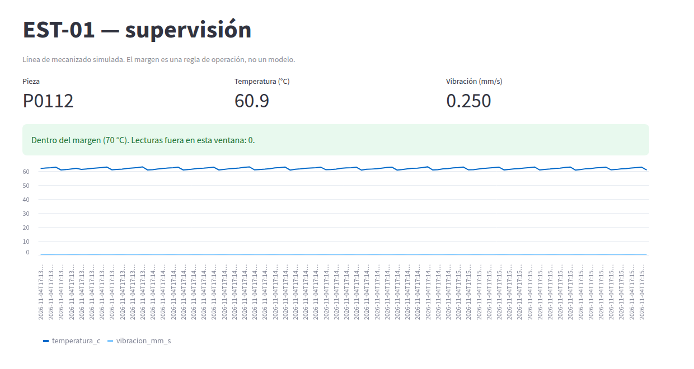

# M01 — Introducción a la IA industrial y arquitecturas basadas en datos

[← Página anterior](../../README.md) · [Siguiente página →](M01-01-arquitectura-datos.md)

> [!NOTE]
> **Cómo funciona este módulo.** Primero la **teoría**, luego la **demostración guiada**, y después **practicas tú** en los laboratorios.

## Qué aprenderás

- Distinguir qué hace la planta (OT), qué hace el sistema de información (IT) y qué añade un modelo.
- Nombrar las piezas de una arquitectura de dato: origen, transporte, almacén, panel y acción.
- Seguir una lectura desde el sensor simulado hasta un indicador.

## Teoría

Una solución industrial con IA no empieza en el modelo. Empieza en una señal de proceso que alguien puede leer, guardar y explicar.

### De la regla fija al modelo

| Etapa | Qué decide | Límite |
|-------|------------|--------|
| Automatismo y SCADA | Umbrales y enclavamientos escritos por una persona | No ve combinaciones raras de varias señales |
| Histórico y MES | Qué ha pasado en el turno | Describe; no anticipa |
| Modelo | Una estimación (defecto, anomalía, asistencia) a partir de ejemplos | Se equivoca, y hay que vigilarlo |

El modelo no sustituye el enclavamiento de seguridad. Informa a una persona o a un automatismo que ya tiene sus propias protecciones.

### IT, OT e IA

- **OT:** lo que mueve la línea. PLC, variadores, sensores, tiempos de ciclo. Prioriza que el proceso no se pare ni se vuelva inseguro.
- **IT:** lo que informa a la fábrica. Bases, informes, identidad, redes de oficina.
- **IA:** una capa que lee datos de las dos y devuelve una estimación. Vive bien cuando el dato llega con hora, unidad y contexto de línea. Vive mal cuando solo hay un Excel mensual.

### Piezas de la arquitectura

1. **Origen.** Sensor, PLC o simulador que emite un hecho: «en esta estación, a esta hora, esta temperatura».
2. **Transporte.** Un canal por el que el hecho viaja sin que el panel tenga que preguntar al PLC a cada instante.
3. **Almacén.** Queda registro para entrenar y para explicar una incidencia de ayer.
4. **Panel.** Convierte el registro en un indicador que operación entiende.
5. **Acción.** Una alarma, una orden de inspección o una ayuda al técnico. Sale del indicador, no del modelo a solas.

> [!NOTE]
> **Dos viajes distintos.** La pieza física viaja por las estaciones de la línea (mecanizado → montaje → calidad). Su **registro** viaja por las piezas de la arquitectura (sensor → transporte → almacén → panel). En el laboratorio solo hay una estación, EST-01: cada mensaje es una pieza distinta que termina su ciclo allí, y lo que cruza es su registro.

### Ciclo de la solución

Problema de planta → datos que de verdad se pueden capturar → modelo pequeño → puesta en marcha → vigilancia → corrección cuando la línea cambia. Si la línea cambia de utillaje y nadie reentrena, el modelo sigue contestando como si nada hubiera pasado.

## Demostración guiada

Se recorre la línea simulada de una sola estación: un generador de lecturas, un sitio donde se acumulan y un panel. La idea que hay que ver es que **la misma pieza** aparece en el origen, en el almacén y en el panel: no son cuatro sistemas desconectados, es un hecho que cruza.

Todo se lanza desde `infra/`.

**1. Levantar el camino del dato.**

```bash
cd infra
docker compose up -d mosquitto sensor archivador
```

**2. Ver los mensajes que viajan** (origen → transporte):

```bash
# Suscríbete a todo lo de la estación y sal tras 3 mensajes
docker compose exec mosquitto mosquitto_sub -t 'linea/est01/#' -v -C 3
```

```text
linea/est01/ciclo {"estacion": "EST-01", "pieza_id": "P0005", "ts": "2026-11-04T17:12:41+00:00", "temperatura_c": 62.74, "vibracion_mm_s": 0.22, "corriente_a": 4.11, "secuencia": 5}
linea/est01/ciclo {"estacion": "EST-01", "pieza_id": "P0006", "ts": "2026-11-04T17:12:42+00:00", "temperatura_c": 63.05, "vibracion_mm_s": 0.235, "corriente_a": 4.01, "secuencia": 6}
linea/est01/ciclo {"estacion": "EST-01", "pieza_id": "P0007", "ts": "2026-11-04T17:12:43+00:00", "temperatura_c": 61.11, "vibracion_mm_s": 0.25, "corriente_a": 4.1, "secuencia": 7}
```

**3. Ver que el almacén guarda las mismas piezas:**

```bash
docker compose logs --tail=3 archivador
```

```text
archivador-1  | archivador: P0005
archivador-1  | archivador: P0006
archivador-1  | archivador: P0007
```

**4. Abrir el panel** en <http://localhost:8501>:

```bash
docker compose up -d panel
```



El panel no «es la IA». Solo demuestra que el dato ya es información operativa. Los modelos llegan en los módulos siguientes, sobre este mismo flujo.

## Ahora practica tú

| Lab | Título | Qué harás |
|-----|--------|-----------|
| M01-01 | [Arquitectura básica de datos](M01-01-arquitectura-datos.md) | Montar origen, transporte, almacén y una primera vista. |
| M01-02 | [Visualización y supervisión de procesos](M01-02-visualizacion-supervision.md) | Leer la estación en indicadores, no en una lista cruda. |

→ Empieza por **[M01-01 — Arquitectura básica de datos](M01-01-arquitectura-datos.md)**.
