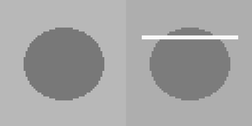

# M04-01 — Clasificación automática de componentes

[← Página anterior](README.md) · [Siguiente página →](M04-02-deteccion-defectos.md)

> Práctica del módulo. La teoría y la demostración están en el [README del módulo](README.md).
>
> Lanza los comandos desde la carpeta `infra/` del repositorio. Un paso que cuadra termina con una línea que empieza por `OK`.

### Objetivo

Entrenas un clasificador que separa componente correcto y defectuoso, y lo pruebas con imágenes que no vio.

### Prerrequisitos

- Solo `lab`. Genera 80 PNG pequeñas en `infra/data/imagenes/`.
- Sin cámara y sin GPU.

### Qué está pasando

Al final de EST-01 hay un **puesto de inspección visual**: una cámara fotografía cada carcasa antes de que pase a la siguiente fase. El defecto que se busca es un **rayón** en la superficie.

Para enseñar a un modelo a separar buenas de malas hacen falta fotos de las dos clases. Aquí hay 80, generadas por el laboratorio: 40 carcasas buenas y 40 con un rayón blanco. El modelo aprende con el 70 % de cada clase y se le examina con el 30 % restante, fotos que no ha visto.

Para el modelo, una foto no es una imagen: es una lista de 256 números, el brillo de cada punto de la foto reducida a 16×16. Sin cámara real y sin GPU.

### 1 — Generar y entrenar

Vas a generar el juego de imágenes, entrenar con el 70 % y medir el acierto con el 30 % que el modelo no ha visto.

```bash
# Genera las imágenes (si faltan), entrena y guarda modelo_vision.joblib
docker compose --profile lab run --rm --no-deps lab m04-01
```

📋 Ficha del comando [`m04-01`](../comandos-lab.md#m04-01): qué hace, qué lee, qué escribe y cuándo da `OK`.

**Resultado esperado:**

```text
acierto_prueba=0.88
OK m04-01: acierto=0.88 en imágenes no usadas al entrenar
```

<details>
<summary>Qué hace por dentro (<code>infra/linea/cli.py</code>)</summary>

```python
def _features_imagen(ruta):
    img = Image.open(ruta).convert("L").resize((16, 16))    # gris y 16×16
    return np.asarray(img, dtype=np.float32).reshape(-1) / 255.0   # 256 números entre 0 y 1

X = np.stack([_features_imagen(r) for r in entreno["ruta"]])
modelo = LogisticRegression(max_iter=400)
modelo.fit(X, entreno["defecto"])                          # cada píxel es una entrada
```

Para el modelo, una imagen es una fila de 256 números: el brillo de cada píxel.

</details>

### 2 — Mirar una de cada

Vas a abrir una imagen buena y una defectuosa. Tienes que ver qué está aprendiendo el modelo: el rayón, no un fondo distinto.

```bash
ls data/imagenes/buenas | head -3        # ok_00.png, ok_01.png…
ls data/imagenes/defectuosas | head -3   # ko_00.png, ko_01.png…
```

Ábrelas en VS Code: `infra/data/imagenes/buenas/ok_00.png` y `infra/data/imagenes/defectuosas/ko_00.png`.

**Resultado esperado:** la defectuosa tiene una línea blanca; la buena, no.



## Comprueba tu entendimiento

**Imágenes nuevas**

El acierto que imprime el comando, ¿de qué imágenes es?

→ Del 30 % apartado, no de las del entrenamiento.

## Reto

### 1 — Atajo

Si todas las malas tuvieran otro fondo, ¿qué podría aprender el modelo?

<details>
<summary>Ver solución</summary>

El fondo en vez del rayón: acertaría aquí y fallaría en planta. En este generador el fondo cambia un poco entre imágenes pero no según la clase; la diferencia que importa es el rayón.

</details>

## Errores frecuentes

| Síntoma | Causa probable | Cómo arreglarlo |
|---------|----------------|-----------------|
| `FALLO: el clasificador visual no separa las piezas` | las imágenes no se generaron bien | borra `data/imagenes` y repite |
| no encuentras los PNG | los buscas dentro del contenedor | están en el disco del puesto, en `infra/data/imagenes` |

## Conclusiones

- **Para un modelo, una imagen es una lista de números**: el brillo de cada punto.
- **Hacen falta ejemplos de las dos clases**, buenas y malas, y se examina con fotos que no se usaron para entrenar.
- **Un 88 % de acierto significa que algunas fotos se clasifican mal.** En inspección eso son defectos que pasan o piezas buenas que se paran.
- **Hay que mirar qué está aprendiendo**: el rayón, y no otra diferencia casual entre las fotos, como el fondo o la iluminación.

> 🔑 Un modelo de visión aprende lo que diferencia a las fotos de entrenamiento, que no siempre es lo que tú querías que aprendiera.
