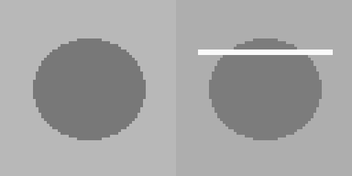

# M04 — Visión artificial para control de calidad

[← Página anterior](../M03-ml-prediccion-anomalias/M03-04-entrenar-datos-linea.md) · [Siguiente página →](M04-01-clasificacion-componentes.md)

> [!NOTE]
> **Cómo funciona este módulo.** Tiene cuatro bloques, uno por laboratorio. En cada bloque: primero la **teoría** y una **demostración** que se proyecta en clase, paso a paso; después **practicas tú** con el laboratorio, a tu ritmo.

## Qué aprenderás

- Cómo «ve» un modelo una foto y cómo aprende a separar piezas buenas de defectuosas.
- La diferencia entre **clasificar** («está mala») y **detectar** («el defecto está aquí»).
- Cómo funciona un **puesto de inspección** completo y quién decide su [umbral](../glosario/03-aprendizaje-automatico.md#umbral).
- Qué es **entrenar una red neuronal**, cómo se sabe si ha aprendido y qué es el [sobreajuste](../glosario/03-aprendizaje-automatico.md#sobreajuste).

| Bloque | Concepto | Laboratorio |
|--------|----------|-------------|
| 1 | Clasificación de imágenes | [M04-01](M04-01-clasificacion-componentes.md) |
| 2 | Detección y localización del defecto | [M04-02](M04-02-deteccion-defectos.md) |
| 3 | Puesto de inspección | [M04-03](M04-03-inspeccion-camara.md) |
| 4 | [Redes neuronales](../glosario/03-aprendizaje-automatico.md#red-neuronal) | [M04-04](M04-04-red-neuronal.md) |

## Antes de empezar

Las fotos de carcasas las genera el primer laboratorio. Para tenerlas ya en la demostración:

```bash
cd infra
docker compose --profile lab run --rm --no-deps lab m04-01
```

No hace falta cámara ni GPU: las fotos son sintéticas y pequeñas, y todo se entrena en CPU en menos de un segundo.

## Introducción: un puesto de inspección visual

Al final de EST-01 hay una **cámara** que fotografía cada carcasa antes de que pase a la siguiente fase. El defecto que se busca es un **rayón** en la superficie. Inspeccionar a ojo es lento y cansado; un modelo de visión puede decidir en milisegundos qué piezas necesitan que alguien las mire.

| En la realidad | En este laboratorio |
|----------------|---------------------|
| Cámara industrial con su iluminación | 80 fotos sintéticas de 64×64 [píxeles](../glosario/03-aprendizaje-automatico.md#vision-pixeles) en `infra/data/imagenes/` |
| Defectos reales: rayones, golpes, rebabas, manchas | Un rayón blanco horizontal |
| Modelo de visión (a menudo una red convolucional) | [Regresión logística](../glosario/03-aprendizaje-automatico.md#regresion-logistica) y una red neuronal pequeña |

---

## Bloque 1 — Clasificación de imágenes

### Teoría

Para un modelo, una foto **no es una imagen**: es una tabla de números. Cada punto (píxel) es el brillo de ese punto, de 0 (negro) a 255 (blanco). Una foto de 16×16 son 256 números en fila, y el modelo aprende qué combinaciones de esos números aparecen en las fotos de cada clase.

Igual que en el M03: se entrena con unas fotos y se examina con otras que el modelo [no ha visto](../glosario/03-aprendizaje-automatico.md#particion).

### Demostración

**Qué se demuestra:** qué fotos hay y qué diferencia a una buena de una defectuosa. En el laboratorio entrenarás el clasificador y probarás qué resolución necesita.

#### Paso 1 — El juego de fotos

**Qué vamos a ver:** el manifiesto, un fichero que apunta qué foto es de qué clase (`infra/data/imagenes/manifiesto.csv`). `lab sql` lo consulta como tabla.

```bash
docker compose --profile lab run --rm --no-deps lab sql \
  "SELECT defecto, COUNT(*) AS fotos FROM manifiesto GROUP BY defecto"
```

**Resultado esperado:**

```text
 defecto  fotos
       0     40
       1     40
```

**Cómo se lee:** 40 carcasas buenas y 40 defectuosas. Están equilibradas a propósito: en una línea real habría muchas más buenas que malas.

#### Paso 2 — Una de cada

**Qué vamos a ver:** se abren en VS Code `infra/data/imagenes/buenas/ok_00.png` y `infra/data/imagenes/defectuosas/ko_00.png`.



**Cómo se lee:** las dos tienen la carcasa gris sobre un fondo algo más claro. La defectuosa tiene una **línea blanca**. Para el modelo, esa línea son unos cuantos números de 250 en una fila donde lo normal es 120.

> **Qué señalar en pantalla:** el fondo no es igual en todas las fotos: cambia un poco de una a otra. Si cambiara según la clase (todas las malas más oscuras, por ejemplo), el modelo aprendería el fondo en lugar del rayón.

#### Paso 3 — La pregunta que abre el laboratorio

> **Si reducimos cada foto a 16 números, ¿seguirá el modelo viendo el rayón?**

### Ahora tú: M04-01

→ **[M04-01 — Clasificación automática de componentes](M04-01-clasificacion-componentes.md)**

Entrenarás el clasificador, lo examinarás con fotos que no ha visto y probarás con fotos de 4×4, 8×8, 16×16 y 32×32 para ver cuánto detalle necesita.

---

## Bloque 2 — Detección y localización del defecto

### Teoría

**Clasificar** responde «¿está mala?». **Detectar** responde «¿dónde?». Retrabajo necesita lo segundo para reparar la pieza o decidir si se puede salvar.

A veces basta una regla sencilla: si el defecto es siempre una línea clara, se busca la fila más brillante de la foto. Cuando los defectos varían en forma y posición, hacen falta modelos de detección entrenados [con ejemplos](../glosario/04-ia-generativa.md#few-shot) marcados.

### Demostración

**Qué se demuestra:** que para medir si un detector acierta hace falta saber dónde está de verdad el defecto. En el laboratorio aplicarás la regla y verás sus límites.

#### Paso 1 — La posición real del rayón

**Qué vamos a ver:** el manifiesto guarda, para cada foto defectuosa, en qué fila (`y`) está el rayón.

```bash
docker compose --profile lab run --rm --no-deps lab sql \
  "SELECT ruta, defecto, y FROM manifiesto WHERE defecto = 1 LIMIT 3"
```

**Resultado esperado:**

```text
                                ruta  defecto    y
/data/imagenes/defectuosas/ko_00.png        1 18.0
/data/imagenes/defectuosas/ko_01.png        1 19.0
/data/imagenes/defectuosas/ko_02.png        1 20.0
```

**Cómo se lee:** el rayón de `ko_00.png` está en la fila 18 (contando desde arriba, de 0 a 63). Es la **verdad** contra la que se mide el detector. En planta, esa verdad la marca una persona sobre cientos de fotos: es el trabajo de **etiquetado**, y suele ser lo más caro de un proyecto de visión.

#### Paso 2 — La pregunta que abre el laboratorio

> **¿Cómo encontraría un programa la fila del rayón, sin saber dónde está? ¿Y qué rayones no encontraría?**

### Ahora tú: M04-02

→ **[M04-02 — Detección automática de defectos](M04-02-deteccion-defectos.md)**

Localizarás el rayón con la regla de la fila más brillante, comprobarás que no marca piezas buenas y moverás el umbral de brillo para ver cuándo empieza a inventarse defectos.

---

## Bloque 3 — Puesto de inspección

### Teoría

Un puesto de inspección es un **flujo**: entra la foto de cada pieza, el modelo da una probabilidad de defecto, un **umbral** la convierte en decisión y queda un **registro** por pieza. No se entrena nada: se usa el modelo que ya existe.

```
 cámara ──▶ carpeta de entrada ──▶ modelo ──▶ probabilidad ──▶ umbral ──▶ aceptar / revisar ──▶ registro
```

### Demostración

**Qué se demuestra:** cómo es el registro de un puesto de inspección y el problema de las piezas cerca del umbral. En el laboratorio pasarás el lote tú, moverás el umbral y añadirás una [zona de duda](../glosario/03-aprendizaje-automatico.md#zona-duda).

#### Paso 1 — El registro de un lote

**Qué vamos a ver:** el registro que deja el puesto tras inspeccionar un lote de 6 carcasas (`infra/data/lote_resultado.csv`, generado al preparar la clase con `lab m04-03`).

```bash
docker compose --profile lab run --rm --no-deps lab sql "SELECT * FROM lote_resultado"
```

**Resultado esperado:**

```text
   imagen  probabilidad_defecto decision
ok_00.png                 0.345  aceptar
ok_01.png                 0.269  aceptar
ok_02.png                 0.314  aceptar
ko_00.png                 0.493  aceptar
ko_01.png                 0.657  revisar
ko_02.png                 0.714  revisar
```

**Cómo se lee:** las tres buenas (`ok_…`) se aceptan. Dos defectuosas (`ko_01`, `ko_02`) van a revisión. Pero `ko_00.png` **es defectuosa y se ha aceptado**: su probabilidad, 0,493, se quedó a siete milésimas del umbral de 0,5.

> **Qué señalar en pantalla:** el modelo «dudaba», y el umbral tomó la decisión por él. Esa carcasa iría al cliente.

#### Paso 2 — La pregunta que abre el laboratorio

> **¿Bajaríais el umbral? ¿A cuánto? ¿Y qué haríais con las piezas que están justo en el límite?**

### Ahora tú: M04-03

→ **[M04-03 — Sistema de inspección basado en cámara](M04-03-inspeccion-camara.md)**

Pasarás el lote por el puesto, moverás el umbral, añadirás una **zona de duda** para que las piezas dudosas las mire una persona y decidirás qué criterio defenderías ante calidad.

---

## Bloque 4 — Redes neuronales

### Teoría

Una **red neuronal** es una cadena de capas de «neuronas». Cada neurona multiplica sus entradas por unos **pesos**, las suma y pasa el resultado a la siguiente. Entrenar es ajustar esos pesos, iteración a iteración, para equivocarse cada vez menos.

Una red tiene **muchos más pesos** que una regresión logística, y por eso puede aprender patrones más complejos. También necesita más ejemplos y es más fácil que **memorice** en lugar de aprender.

### Demostración

**Qué se demuestra:** cuánto más grande es una red que un modelo sencillo, mirando los ficheros de los dos modelos. En el laboratorio la entrenarás y la verás aprender, no aprender y memorizar.

#### Paso 1 — Dos modelos, dos tamaños

**Qué vamos a ver:** el fichero de la regresión logística del M04-01 y el de una red neuronal entrenada con las mismas fotos (generada al preparar la clase con `lab m04-red`).

```bash
ls -l data/modelo_vision.joblib data/modelo_vision_red.joblib
```

**Resultado esperado:**

```text
-rw-r--r-- 1 root root   2911 … data/modelo_vision.joblib
-rw-r--r-- 1 root root 219108 … data/modelo_vision_red.joblib
```

**Cómo se lee:**

| Modelo | Pesos que aprende | Fichero |
|--------|-------------------|---------|
| Regresión logística | 256 (uno por píxel) + 1 | ~3 KB |
| Red de 64 neuronas | 256 × 64 + 64 (capa oculta) + 64 + 1 (salida) = 16 513 | ~214 KB |

La red tiene **unas 65 veces más pesos** que aprender con las mismas 56 fotos.

> **Qué señalar en pantalla:** más pesos significa más capacidad para aprender, y también más capacidad para memorizar. Con 56 fotos, ¿cuál de las dos cosas hará?

#### Paso 2 — La pregunta que abre el laboratorio

> **¿Cómo se sabe si una red ha aprendido a reconocer un rayón o simplemente se ha aprendido de memoria las fotos de entrenamiento?**

### Ahora tú: M04-04

→ **[M04-04 — Entrenar una red neuronal](M04-04-red-neuronal.md)**

Entrenarás la red en CPU, leerás cómo baja su pérdida, la dejarás sin tiempo para aprender, cambiarás su tamaño y provocarás el sobreajuste entrenándola con solo seis fotos.

---

## Conclusiones del módulo

### Qué es la visión artificial en control de calidad

Convertir cada foto en números y aprender qué patrones de números corresponden a cada clase o a cada defecto. Un puesto de inspección añade el umbral, el registro y la decisión de qué hacer con las piezas dudosas.

### Cómo debe hacerse

| Requisito | Dónde lo has trabajado |
|-----------|------------------------|
| Examinar con fotos que el modelo no ha visto | M04-01, M04-04 |
| Usar el detalle justo (resolución) | M04-01 |
| Medir la detección contra una verdad etiquetada | M04-02 |
| Decidir el umbral con calidad, con zona de duda | M04-03 |
| Comprobar que una red no ha memorizado | M04-04 |

### Lo que has visto romperse

| Fallo | Dónde | Qué enseña |
|-------|-------|------------|
| Con 4×4 o 8×8 píxeles, el clasificador no separa | M04-01 | Si se pierde el detalle del defecto, ningún modelo lo ve |
| Un umbral de brillo bajo marca piezas buenas | M04-02 | Una regla sencilla tiene límites claros |
| Una carcasa defectuosa aceptada por 0,007 | M04-03 | El umbral decide por el modelo cuando duda |
| Una red que acierta todo lo que vio y la mitad de lo nuevo | M04-04 | Sobreajuste: memorizar no es aprender |

### En una frase

> 🔑 Un modelo de visión aprende de los ejemplos que le das y decide con el umbral que le pones: las dos cosas son decisiones de calidad, no del modelo.
