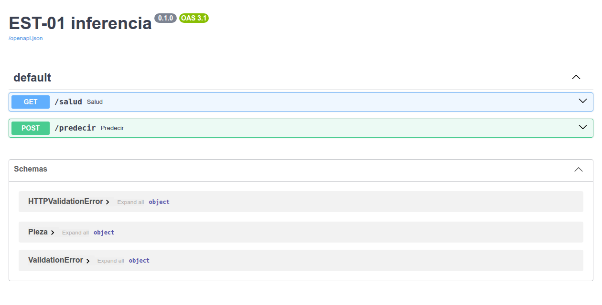

# M07-01 — Publicación de servicios de inferencia

[← Página anterior](README.md) · [Siguiente página →](M07-02-monitorizacion.md)

> Práctica del módulo. La teoría y la demostración están en el [README del módulo](README.md).
>
> Lanza los comandos desde la carpeta `infra/` del repositorio. Un paso que cuadra termina con una línea que empieza por `OK`.

### Objetivo

Comprender qué es **publicar un modelo como servicio**: por qué se hace, cómo debe ser su contrato, qué riesgos evita y cómo se mantiene bajo control cuando hay varias versiones.

### Prerrequisitos

- M03-03 hecho (`data/modelo_defecto.joblib` y `data/VERSION`).
- Puerto 8000 libre. Techo del contenedor: 768 MB.

### Qué está pasando

El [dictamen](../glosario/05-operacion-gobierno.md#dictamen) ya no lo quiere solo la línea. El **MES** lo quiere para la [trazabilidad](../glosario/05-operacion-gobierno.md#trazabilidad), **calidad** para su panel y **mantenimiento** para su tablet. Copiar el fichero del modelo en cada aplicación sería un caos: cada una acabaría con una versión distinta.

La solución es publicar el modelo como un **servicio**: un único proceso que recibe las señales de una pieza y devuelve el dictamen. Todas las aplicaciones le preguntan a él.

Cada respuesta dice **qué versión del modelo contestó**, y cada consulta queda apuntada en un registro con su entrada y su salida. Si una pieza llega sin señales, el servicio la rechaza: no [se inventa](../glosario/04-ia-generativa.md#alucinacion) los datos que faltan.

### 1 — Arrancar el servicio

Vas a levantar el servicio de [inferencia](../glosario/05-operacion-gobierno.md#inferencia) y preguntarle si está listo y qué versión sirve.

```bash
docker compose up -d api

curl -s http://localhost:8000/salud
```

**Resultado esperado:**

```json
{"estado":"ok","version":"defecto-0.1","huella_modelo":"69a897cdf955"}
```

`huella_modelo` es un código calculado a partir del fichero del modelo (los primeros 12 caracteres de su SHA-256): si cambia un solo byte del modelo, cambia la [huella](../glosario/05-operacion-gobierno.md#version-huella). La tuya puede ser distinta de la del ejemplo si tu modelo se entrenó de otra forma. Lo usarás en «Experimenta».

El servicio documenta su propio contrato en <http://localhost:8000/docs>:



### 2 — Pedir un dictamen

Vas a mandar las señales de una pieza como lo haría una aplicación de planta. Las aplicaciones llaman al servicio; no abren el fichero del modelo.

```bash
# Pieza con temperatura normal
curl -s -X POST http://localhost:8000/predecir \
  -H 'Content-Type: application/json' \
  -d '{"pieza_id": "DEMO1", "temperatura_c": 61.4, "vibracion_mm_s": 0.25, "corriente_a": 4.1, "presion_bar": 6.0}'

# La misma pieza, 8 °C más caliente
curl -s -X POST http://localhost:8000/predecir \
  -H 'Content-Type: application/json' \
  -d '{"pieza_id": "DEMO2", "temperatura_c": 69.4, "vibracion_mm_s": 0.25, "corriente_a": 4.1, "presion_bar": 6.0}'
```

**Resultado esperado:**

```json
{"pieza_id":"DEMO1","version":"defecto-0.1","huella_modelo":"69a897cdf955","entrada":{…},"dictamen":"seguir","probabilidad":0.0798,"ts":"…"}
{"pieza_id":"DEMO2","version":"defecto-0.1","huella_modelo":"69a897cdf955","entrada":{…},"dictamen":"revisar","probabilidad":1.0,"ts":"…"}
```

Cada respuesta lleva la versión y la huella del modelo que la dio. Fíjate: con 8 °C más, la misma pieza pasa de 0,08 a 1,0 de probabilidad.

### 3 — Comprobar el contrato completo

Vas a ejecutar la comprobación del laboratorio: una pieza correcta tiene que dar dictamen con la versión de `/salud`, y una pieza sin señales tiene que rechazarse.

```bash
docker compose --profile lab run --rm --no-deps lab m07-01
```

📋 Ficha del comando [`m07-01`](../comandos-lab.md#m07-01): qué hace, qué lee, qué escribe y cuándo da `OK`.

**Resultado esperado:**

```text
{"pieza_id": "SRV0001", "version": "defecto-0.1", "huella_modelo": "69a897cdf955", "entrada": {"pieza_id": "SRV0001", "temperatura_c": 61.39, "vibracion_mm_s": 0.286, "corriente_a": 4.07, "presion_bar": 5.96}, "dictamen": "seguir", "probabilidad": 0.0798, "ts": "…"}
OK m07-01: version=defecto-0.1 dictamen=seguir
```

## Comprueba tu entendimiento

**La versión viaja**

Lee la versión de la última línea del registro de predicciones.

```bash
tail -1 data/predicciones.jsonl
```

→ `"version": "defecto-0.1"`, la misma que `/salud`.

## Experimenta: cambiar la versión

**Qué ocurre:** la versión la lee el servicio del fichero `infra/data/VERSION` al arrancar. Vas a cambiar ese fichero a `defecto-0.2` **sin cambiar el modelo**, recrear el servicio y mirar qué dice.

```bash
# Cambia la etiqueta de versión (el fichero es del contenedor: se escribe desde uno)
docker compose --profile lab run --rm --no-deps --entrypoint sh lab -c "echo defecto-0.2 > /data/VERSION"

# Antes de recrear: el servicio sigue con lo que leyó al arrancar
curl -s http://localhost:8000/salud

# Recrea el servicio para que vuelva a leer el fichero
docker compose up -d --force-recreate api
sleep 5
curl -s http://localhost:8000/salud
```

**Resultado esperado:**

```json
{"estado":"ok","version":"defecto-0.1","huella_modelo":"69a897cdf955"}
{"estado":"ok","version":"defecto-0.2","huella_modelo":"69a897cdf955"}
```

**Cómo se lee:** después de recrearlo, el servicio dice `defecto-0.2`, pero la **huella es la misma**: el modelo es exactamente el mismo. La versión es una etiqueta que cualquiera puede cambiar; la huella sale del propio fichero. Si un auditor solo mirara la versión, creería que la línea usa un modelo nuevo.

Vuelve a dejarlo como estaba:

```bash
docker compose --profile lab run --rm --no-deps --entrypoint sh lab -c "echo defecto-0.1 > /data/VERSION"
docker compose up -d --force-recreate api
```

## Reto

### 1 — Pieza incompleta

Manda una pieza solo con `pieza_id`. ¿Qué devuelve el servicio?

```bash
curl -s -w '\nHTTP %{http_code}\n' -X POST http://localhost:8000/predecir \
  -H 'Content-Type: application/json' -d '{"pieza_id": "X"}'
```

<details>
<summary>Ver solución</summary>

Un error `HTTP 422` con la lista de campos que faltan (`temperatura_c`, `vibracion_mm_s`…). No hay dictamen: el servicio no se inventa las señales.

</details>

## Mejora: comprobar la huella tú

**Qué ocurre:** compruebas que la huella que dice el servicio es la del fichero que hay en disco. Es lo que haría un auditor para confirmar qué modelo está en producción.

```bash
# SHA-256 del fichero del modelo; los primeros 12 caracteres
sha256sum data/modelo_defecto.joblib | cut -c1-12

# Lo que dice el servicio
curl -s http://localhost:8000/salud
```

**Resultado esperado:**

```text
69a897cdf955
{"estado":"ok","version":"defecto-0.1","huella_modelo":"69a897cdf955"}
```

**Cómo se lee:** coinciden: el modelo que contesta es el del fichero. Si alguien sustituyera el fichero (por ejemplo, volviendo a lanzar `m03-03` con otros datos) y no recreara el servicio, la huella del disco y la del servicio dejarían de coincidir: el servicio seguiría contestando con el modelo anterior. En una plataforma de [MLOps](../glosario/05-operacion-gobierno.md#mlops), cada modelo se registra con su huella, sus datos de entrenamiento y sus [métricas](../glosario/02-observabilidad.md#metrica), y la versión se asigna a esa huella, no a mano.

## Constrúyelo tú: tu propio servicio de inferencia

**Qué está pasando:** el servicio del puerto 8000 está escrito en `infra/linea/inferencia_api.py`. Ahora escribes tú uno igual, pieza a pieza, con la misma librería (FastAPI): defines qué tiene que traer cada petición, qué devuelve la salud y qué devuelve un dictamen, con su versión y su huella. Lo pruebas sin arrancar ningún contenedor, con un cliente de pruebas que llama a tu servicio desde el mismo script, y al final le enseñas a **rechazar** una pieza imposible.

**Cómo se trabaja en cada paso:**

1. Lees para qué es el paso y qué hace el bloque.
2. Copias el bloque y lo pegas en el fichero, **debajo del comentario de ese paso** (`# --- PASO N …`), en lugar de la línea `# (pega aquí el bloque del paso N)`.
3. Guardas y ejecutas el script. Cada ejecución repite todo desde el principio, así que la salida crece paso a paso: lo nuevo aparece al final.

### 1 — Abrir el fichero y ejecutarlo tal cual

**Para qué:** saber qué modelo va a servir tu servicio, antes de escribirlo.

**Qué ocurre:** abres en VS Code el fichero [`infra/construye/m07_01_mi_servicio.py`](../../infra/construye/m07_01_mi_servicio.py). El paso 1 ya está escrito: carga el modelo del M03-03, lee su versión y calcula su huella, como hace `inferencia_api.py` al arrancar. Lo ejecutas sin tocar nada.

```bash
# Ejecuta tu script con el Python del contenedor lab (-W ignore oculta avisos de las librerías)
docker compose --profile lab run --rm --no-deps --entrypoint python lab -W ignore /construye/m07_01_mi_servicio.py
```

**Resultado esperado:**

```text
servirá el modelo defecto-0.1 con huella 69a897cdf955
```

**Cómo se lee:** la misma versión y la misma huella que devuelve `curl http://localhost:8000/salud`: es el mismo fichero. `--entrypoint python` hace que el contenedor `lab` ejecute **tu fichero**.

### 2 — El contrato de entrada

**Para qué:** que el servicio sepa exactamente qué tiene que traer cada petición, y rechace lo demás.

**Qué ocurre:** describes una pieza como una clase: un identificador y cuatro señales numéricas. FastAPI usará esta descripción para comprobar cada petición antes de que llegue al modelo.

Pega debajo de `# --- PASO 2`:

```python
class Pieza(BaseModel):
    pieza_id: str
    temperatura_c: float
    vibracion_mm_s: float
    corriente_a: float
    presion_bar: float

print("contrato de entrada:", list(Pieza.model_fields))
```

Ejecuta de nuevo (el mismo comando del paso 1).

**Resultado esperado** (líneas nuevas):

```text
contrato de entrada: ['pieza_id', 'temperatura_c', 'vibracion_mm_s', 'corriente_a', 'presion_bar']
```

**Cómo se lee:** cinco campos, cada uno con su tipo. Es el **contrato**: lo que el servicio promete aceptar. Una aplicación de planta que quiera un dictamen sabe qué mandar sin leer el código del modelo.

### 3 — La salud del servicio

**Para qué:** que cualquiera pueda preguntar si el servicio está vivo y qué modelo tiene cargado.

**Qué ocurre:** creas la aplicación y su primera dirección, `/salud`, que devuelve el estado, la versión y la huella.

Pega debajo de `# --- PASO 3`:

```python
app = FastAPI(title="mi servicio de inferencia")

@app.get("/salud")
def salud():
    return {"estado": "ok", "version": VERSION, "huella_modelo": HUELLA}

print("direcciones del servicio:", [r.path for r in app.routes if r.path in ("/salud", "/predecir")])
```

**Resultado esperado** (líneas nuevas):

```text
direcciones del servicio: ['/salud']
```

**Cómo se lee:** el servicio existe, aunque todavía no lo ha llamado nadie. `@app.get("/salud")` dice: cuando alguien pida `GET /salud`, ejecuta esta función y devuelve su resultado en JSON. Es lo que mira un sistema de monitorización para saber si el servicio está vivo y con qué modelo.

### 4 — El dictamen

**Para qué:** que cada respuesta diga qué decidió y con qué modelo exacto, para poder rastrearla.

**Qué ocurre:** añades `POST /predecir`: recibe una `Pieza`, pide la probabilidad al modelo y devuelve la decisión junto con la hora, la versión y la huella.

Pega debajo de `# --- PASO 4`:

```python
@app.post("/predecir")
def predecir(pieza: Pieza):
    fila = pd.DataFrame([pieza.model_dump(exclude={"pieza_id"})])
    p = float(MODELO.predict_proba(fila)[0, 1])
    return {"pieza_id": pieza.pieza_id, "dictamen": "revisar" if p >= 0.5 else "seguir", "probabilidad": round(p, 3),
            "ts": datetime.now(timezone.utc).isoformat(timespec="seconds"), "version": VERSION, "huella_modelo": HUELLA}

print("direcciones del servicio:", [r.path for r in app.routes if r.path in ("/salud", "/predecir")])
```

**Resultado esperado** (líneas nuevas):

```text
direcciones del servicio: ['/salud', '/predecir']
```

**Cómo se lee:** ya tiene las dos direcciones del servicio del lab. Fíjate en que `predecir` no comprueba nada a mano: si la petición no cumple el contrato del paso 2, FastAPI la rechaza antes de llamar a la función.

### 5 — Llamarlo como un cliente

**Para qué:** probar el servicio de verdad, por HTTP, sin arrancar ningún contenedor.

**Qué ocurre:** creas un cliente de pruebas, que habla con tu `app` por HTTP dentro del mismo script, y le pides la salud y el dictamen de una pieza de `limpio.csv`.

Pega debajo de `# --- PASO 5`:

```python
cliente = TestClient(app)
print("GET /salud ->", cliente.get("/salud").json())
pieza = pd.read_csv("/data/limpio.csv").iloc[0]
cuerpo = {"pieza_id": pieza["pieza_id"], **{c: float(pieza[c]) for c in ["temperatura_c", "vibracion_mm_s", "corriente_a", "presion_bar"]}}
r = cliente.post("/predecir", json=cuerpo)
print(f"POST /predecir -> HTTP {r.status_code}", r.json())
```

**Resultado esperado** (líneas nuevas; cambia la hora):

```text
GET /salud -> {'estado': 'ok', 'version': 'defecto-0.1', 'huella_modelo': '69a897cdf955'}
POST /predecir -> HTTP 200 {'pieza_id': 'H0001', 'dictamen': 'seguir', 'probabilidad': 0.08, 'ts': '2026-11-06T15:08:01+00:00', 'version': 'defecto-0.1', 'huella_modelo': '69a897cdf955'}
```

**Cómo se lee:** las mismas respuestas que da el servicio del puerto 8000 con `curl`: has escrito un servicio de inferencia completo en unas veinte líneas. El cliente de pruebas es lo que se usa para comprobar un servicio antes de desplegarlo.

### 6 — Decide tú: una pieza imposible

**Para qué:** comprobar si el contrato basta para proteger al modelo de datos absurdos.

**Qué ocurre:** añades al final este bloque, que manda una pieza con 9999 °C, el valor del sensor clavado del M02-03, y ejecutas:

```python
# Una pieza con el sensor de temperatura clavado
falsa = {**cuerpo, "pieza_id": "CLAVADO", "temperatura_c": 9999}
r = cliente.post("/predecir", json=falsa)
print(f"9999 °C -> HTTP {r.status_code}", r.json())
```

**Resultado esperado** (la línea nueva):

```text
9999 °C -> HTTP 200 {'pieza_id': 'CLAVADO', 'dictamen': 'revisar', 'probabilidad': 1.0, 'ts': '2026-11-06T15:08:04+00:00', 'version': 'defecto-0.1', 'huella_modelo': '69a897cdf955'}
```

**Cómo se lee:** **el servicio la acepta y da un dictamen**, «revisar» con probabilidad 1,0: 9999 es un número válido para el contrato, y el modelo nunca vio nada parecido. Esta vez acierta por casualidad; con un valor imposible en otra señal podría decir «seguir». Ahora cambia en el paso 2 la línea `temperatura_c: float` por `temperatura_c: float = Field(ge=0, le=150)` (de 0 a 150 °C) y vuelve a ejecutar:

```text
9999 °C -> HTTP 422 {'detail': [{'type': 'less_than_equal', 'loc': ['body', 'temperatura_c'], 'msg': 'Input should be less than or equal to 150', 'input': 9999, 'ctx': {'le': 150.0}}]}
```

Ahora **la rechaza** con el motivo, sin llegar al modelo. Un contrato que solo dice «un número» deja pasar lo imposible; un buen contrato pone los rangos físicos de cada señal. Quita el bloque cuando acabes, y deja el rango: es una mejora.
## Errores frecuentes

| Síntoma | Causa probable | Cómo arreglarlo |
|---------|----------------|-----------------|
| `curl: (7) Failed to connect` | `api` no arrancó, normalmente porque faltaba el `.joblib` | `docker compose logs api`; si falta el modelo, `m03-03` y `docker compose up -d api` |
| responde otra versión | el contenedor arrancó con un `VERSION` viejo | `docker compose up -d --force-recreate api` |
| `NameError: name '…' is not defined` | pegaste un bloque en el hueco de otro paso, o te saltaste uno | cada bloque va debajo de su `# --- PASO N`, en orden |
| `IndentationError` | el bloque quedó con espacios de más o de menos al pegarlo | las líneas de cada bloque empiezan en la columna 0, salvo las de dentro de `for`, `if`, `while` y `def` |
| `ModuleNotFoundError` | ejecutaste el script con el Python de tu equipo | ejecútalo con el comando del paso 1, dentro del contenedor `lab` |
| `FileNotFoundError: /data/modelo_defecto.joblib` | no hiciste el M03-03 | lanza `lab m03-03` |

## Conclusiones

### Qué es un servicio de inferencia

Es un único proceso que tiene cargado el modelo y responde a cualquier aplicación que le mande las señales de una pieza. Las aplicaciones no tienen el modelo: le preguntan al servicio.

```
 MES ─────┐
 calidad ─┼──▶ POST /predecir ──▶ servicio (modelo defecto-0.1) ──▶ dictamen + versión
 tablet ──┘                                 └──▶ predicciones.jsonl
```

### Cómo debe ser su contrato

| Requisito | En el lab |
|-----------|-----------|
| Documentado | `/docs` describe qué recibe y qué devuelve |
| Dice si está listo y qué versión sirve | `/salud` → `defecto-0.1` |
| Cada respuesta lleva la versión | `"version": "defecto-0.1"` |
| Cada consulta queda registrada | Una línea en `predicciones.jsonl` con entrada y salida |
| No se inventa datos | Una pieza sin señales se rechaza con `HTTP 422` |

### Qué riesgos evita

- **Versiones distintas en cada aplicación**: todas usan el mismo modelo.
- **Dictámenes sin explicación**: cada uno queda con su entrada y su versión.
- **Datos incompletos que pasan**: el servicio los rechaza.

### Cómo se mantiene bajo control

- Cambiar de modelo es **desplegar una versión nueva** del servicio, no copiar ficheros.
- La versión se carga **al arrancar**, y un cambio de fichero no tiene efecto hasta reiniciar (lo comprobarás en M08-02).
- Se vigila su **comportamiento** con el tiempo (M07-02).

### En una frase

> 🔑 Publicar el modelo como servicio da un único punto de decisión, con contrato, versión y registro. Si no sabes qué versión dio un dictamen, no puedes explicarlo.
