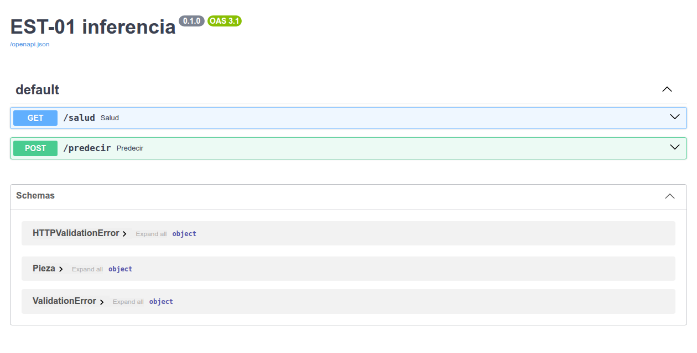

# M07 — Operación, MLOps y observabilidad

[← Página anterior](../M06-edge-integracion-ot/M06-03-prediccion-actuacion.md) · [Siguiente página →](M07-01-servicio-inferencia.md)

> [!NOTE]
> **Cómo funciona este módulo.** Tiene tres bloques, uno por laboratorio. En cada bloque: primero la **teoría** y una **demostración** que se proyecta en clase, paso a paso; después **practicas tú** con el laboratorio, a tu ritmo.

## Qué aprenderás

- Cómo se publica un modelo como **servicio** y cómo se sabe qué modelo exacto ha dado cada dictamen.
- Por qué un modelo **se degrada sin avisar** y cómo se vigila.
- Cómo un **agente local** puede diagnosticar las incidencias de la operación, y cómo se revisa lo que propone.

| Bloque | Concepto | Laboratorio |
|--------|----------|-------------|
| 1 | Servicio de inferencia | [M07-01](M07-01-servicio-inferencia.md) |
| 2 | Monitorización y deriva | [M07-02](M07-02-monitorizacion.md) |
| 3 | Gestión de incidencias con un agente | [M07-03](M07-03-incidencias-agente.md) |

## Antes de empezar

El bloque 1 y 2 necesitan el modelo de defecto del M03-03. El bloque 3, Prometheus (M01-03) y el modelo de lenguaje (M05).

```bash
cd infra
docker compose up -d mosquitto sensor archivador prometheus
docker compose up -d api
```

## Introducción: un modelo en producción no está terminado

Poner un modelo en marcha no es el final del trabajo. **MLOps** es todo lo que viene después: desplegarlo de forma controlada, saber en todo momento qué versión está contestando, vigilar si sigue sirviendo y tener un procedimiento cuando algo falla.

```
 entrenar ──▶ versionar ──▶ desplegar como servicio ──▶ vigilar ──▶ ¿degradado? ──▶ reentrenar ──▶ versionar…
```

---

## Bloque 1 — Servicio de inferencia

### Teoría

Si cada aplicación (MES, panel de calidad, tablet de mantenimiento) tuviera su copia del modelo, cada una acabaría con una versión distinta. Por eso el modelo se publica como un **servicio**: un único proceso que tiene el modelo cargado y responde a todas.

Para poder explicar cada dictamen, el servicio dice **qué versión** contestó. Pero una versión es una **etiqueta** que alguien escribe. Lo que identifica el modelo exacto es su **huella**: un código calculado a partir del propio fichero, que cambia si cambia un solo byte.

### Demostración

**Qué se demuestra:** el servicio, su contrato y cómo se identifica. En el laboratorio lo llamarás como una aplicación y comprobarás qué pasa al cambiar la versión.

#### Paso 1 — El servicio, en el navegador

Abre <http://localhost:8000/salud>:

```json
{"estado":"ok","version":"defecto-0.1","huella_modelo":"69a897cdf955"}
```

**Cómo se lee:**

| Campo | Qué es |
|-------|--------|
| `version` | La etiqueta que se leyó del fichero `infra/data/VERSION` al arrancar |
| `huella_modelo` | Los primeros 12 caracteres del SHA-256 del fichero del modelo: identifica el modelo exacto |

Y <http://localhost:8000/docs>: el contrato del servicio, con `GET /salud` y `POST /predecir`.



> **Qué señalar en pantalla:** «Dos aplicaciones que vean la misma huella están usando el mismo modelo, byte a byte. Si la huella cambia, ha cambiado el modelo, diga lo que diga la versión».

#### Paso 2 — La pregunta que abre el laboratorio

> **Si alguien cambia el fichero `VERSION` a `defecto-0.2` sin cambiar el modelo, ¿qué dirá el servicio? ¿Se daría cuenta alguien?**

### Ahora tú: M07-01

→ **[M07-01 — Publicación de servicios de inferencia](M07-01-servicio-inferencia.md)**

Pedirás dictámenes como una aplicación, comprobarás que el servicio rechaza piezas incompletas, cambiarás la versión y descubrirás qué identifica de verdad al modelo.

---

## Bloque 2 — Monitorización y deriva

### Teoría

Un modelo aprende con una línea concreta. Si la línea **cambia** (otro refrigerante, el verano, otra herramienta), el modelo sigue contestando como si nada, pero sus dictámenes dejan de tener sentido. Esto se llama **deriva**, y no da ningún error.

La única forma de verla es **vigilar**: comparar lo que recibe y lo que dice el modelo hoy con lo que recibía y decía cuando se entrenó.

### Demostración

**Qué se demuestra:** cómo se compara la línea de hoy con la del entrenamiento. En el laboratorio verás qué le hace la deriva al modelo y la medirás en la línea en vivo.

#### Paso 1 — Lo que aprendió el modelo

```bash
# Temperatura y vibración medias de las piezas con las que se entrenó
docker compose --profile lab run --rm --no-deps lab sql \
  "SELECT ROUND(AVG(temperatura_c), 2) AS media_entrenamiento, ROUND(AVG(vibracion_mm_s), 3) AS vib_entrenamiento
   FROM limpio"
```

```text
 media_entrenamiento  vib_entrenamiento
               62.04               0.25
```

#### Paso 2 — Lo que está viendo ahora

```bash
# Las mismas medias en las últimas 120 carcasas de la línea
docker compose --profile lab run --rm --no-deps lab sql \
  "SELECT ROUND(AVG(temperatura_c), 2) AS media_linea_ahora, ROUND(AVG(vibracion_mm_s), 3) AS vib_linea_ahora
   FROM (SELECT temperatura_c, vibracion_mm_s FROM lecturas ORDER BY id DESC LIMIT 120)"
```

**Resultado esperado** (depende de lo que haya pasado en la línea; tras un fallo de refrigeración del M06-03, por ejemplo):

```text
 media_linea_ahora  vib_linea_ahora
             65.17             0.25
```

**Cómo se lee:** la vibración es la misma, pero la temperatura media está **3 °C por encima** de la que vio el modelo al entrenar. El modelo no lo sabe: sigue dictaminando como si la línea fuera la de entonces.

> **Qué señalar en pantalla:** «Esto es vigilar la **entrada** del modelo. En el laboratorio vigilaréis también su **salida**: cuántas piezas manda a revisión».

#### Paso 3 — La pregunta que abre el laboratorio

> **Con la línea 3 °C más caliente, ¿cuántas piezas buenas mandará el modelo a revisión?**

### Ahora tú: M07-02

→ **[M07-02 — Monitorización y seguimiento operacional](M07-02-monitorizacion.md)**

Medirás la tasa de piezas a revisión con el proceso normal y desplazado, con 2, 4 y 8 °C de más, y en la línea en vivo durante un fallo de refrigeración.

---

## Bloque 3 — Gestión de incidencias con un agente

### Teoría

Cuando salta una alerta, alguien tiene que entender qué pasa, buscar los datos y decidir qué hacer. Un **agente de incidencias** hace el primer trabajo: reúne los datos con herramientas de lectura, consulta el **runbook** (el procedimiento de incidencias) y redacta un diagnóstico con la acción propuesta. **No ejecuta nada.**

### Demostración

**Qué se demuestra:** lo que el agente tiene a mano: las alertas y el runbook. En el laboratorio lo verás diagnosticar una incidencia real y aprenderás a revisar lo que dice.

#### Paso 1 — Las alertas activas

Abre <http://localhost:9090/alerts>. Con la línea sana, todas en verde.

#### Paso 2 — El runbook

```bash
cat linea/docs/runbook-est01.md
```

**Resultado esperado** (extracto):

```text
## HistoricoSinDatos

El archivador está vivo pero no guarda registros. Causa habitual: el broker se reinició y el archivador no renovó su suscripción.
Acción: reiniciar el archivador (docker compose restart archivador) y comprobar que vuelve a guardar.
Si se repite, corregir la reconexión del archivador.
```

**Cómo se lee:** una sección por alerta, con su causa habitual y su acción. El agente solo puede proponer lo que diga aquí.

> **Qué señalar en pantalla:** «El agente es tan bueno como este documento. Si el runbook está desactualizado, el agente propondrá cosas desactualizadas con total seguridad».

#### Paso 3 — La pregunta que abre el laboratorio

> **Si el agente dice algo que contradice lo que ha medido, ¿cómo os daríais cuenta?**

### Ahora tú: M07-03

→ **[M07-03 — Gestión de incidencias con un agente local](M07-03-incidencias-agente.md)**

Provocarás una incidencia, el agente la diagnosticará con un modelo local, revisarás su diagnóstico contra los hechos, actuarás tú, cambiarás el runbook y le añadirás una herramienta.

---

## Conclusiones del módulo

### Qué es operar un modelo

Desplegarlo como un servicio identificable, vigilar que la línea sigue pareciéndose a la que aprendió, y tener un procedimiento (y quizá un asistente) para cuando algo falla.

### Cómo debe hacerse

| Requisito | Dónde lo has trabajado |
|-----------|------------------------|
| Un único servicio, con contrato y registro de cada consulta | M07-01 |
| Identificar el modelo exacto, no solo su etiqueta | M07-01 |
| Vigilar la entrada y la salida del modelo frente a una línea base | M07-02 |
| Diagnóstico asistido, con hechos medidos y decisión humana | M07-03 |

### Lo que has visto romperse

| Fallo | Dónde | Qué enseña |
|-------|-------|------------|
| La versión dice 0.2 y el modelo es el mismo | M07-01 | La etiqueta no identifica el modelo; la huella, sí |
| +4 °C y la mitad de las piezas a revisión | M07-02 | La deriva no da errores: hay que medirla |
| Un diagnóstico que contradice los datos | M07-03 | Lo que redacta el modelo se comprueba contra los hechos |

### En una frase

> 🔑 Un modelo en producción hay que poder identificarlo, vigilarlo y corregirlo, porque se degrada sin avisar y nadie lo nota si no lo mide.
